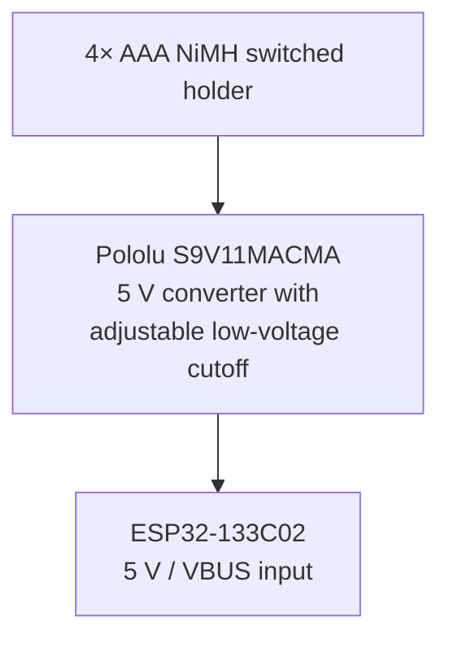
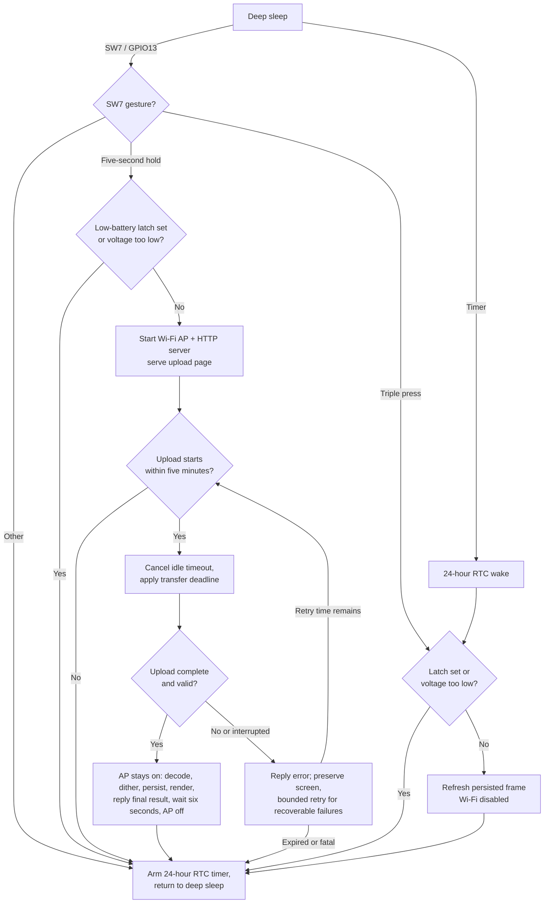

# hof_frame project plan

## Project

Build a Hall of Fame frame around a 13.3-inch GDEP133C02 Spectra 6 color e-ink display and Good Display ESP32-133C02 controller, powered by four AAA NiMH cells and eventually running custom Rust firmware.

## Hardware

- Display: Good Display GDEP133C02, 13.3-inch, 1600×1200, Spectra 6 color e-ink.
- Controller: Good Display ESP32-133C02 with ESP32-S3-WROOM-1.
- Memory: 16 MB flash and 8 MB octal PSRAM, corroborated by third-party research of Good Display's firmware (not yet measured on this board); confirm usable configuration during bring-up.
- Wake button: the received board's user switches are **SW8 on GPIO12 and SW7 on GPIO13, both pull-up, active-low inputs** (released HIGH, pressed LOW). The firmware uses GPIO13/SW7 as the deep-sleep wake button; the current cycle test refreshes once per wake. The documented SW2/SW3/SW4 buttons are not fitted on this board.
- Battery-sense ADC: **GPIO14 / ADC2_CH3, ESP32-S3-WROOM-1 module pad 22**, selected after the user reported an accessible pad and no interfering board connection. Sample before starting Wi-Fi because this is ADC2. GPIO4 was not selected after the user found continuity to a microSD socket joint. Firmware and the executable wiring model still need updating; see [WIRING.md](WIRING.md) for measurement and power-sequencing notes.
- Battery: four matched Green Cell AAA (R03) 950 mAh NiMH cells in a series holder. The series pack is 950 mAh at approximately 4.8 V nominal (4.56 Wh nominal).
- Battery holder: [Allegro 4×AAA holder with integrated switch](https://allegro.pl/produkt/koszyk-na-4-baterie-aaa-4xaaa-z-wlacznikiem-czarny-4c5bce7c-e839-49d4-b6d2-8abc42cdc347?offerId=17382812988).
- Reverse-polarity protection: none. The battery holder fixes the cell polarity, so a protector module was dropped to keep the first build simple and to save its quiescent current and voltage drop.
- Voltage converter: [Pololu S9V11MACMA #2868](https://www.pololu.com/product/2868), a step-up/step-down converter set to 5.0 V with a built-in adjustable low-voltage cutoff.
- Charging: remove the cells and use a dedicated four-cell NiMH charger. Do not use a Li-ion TP4056 charger or an improvised constant-voltage charger.

### Power path



The four-cell pack is approximately 4.8 V nominal and may be close to 6 V immediately after charging. The S9V11MACMA accepts the pack's voltage range and regulates the controller supply. A fuse or resettable PTC is optional overcurrent protection, not a voltage-compatibility requirement. The converter powers the controller through its USB-C input. The as-built setup omits the planned series Schottky diode, so never connect computer or charger USB at the same time; see the bring-up notes in [WIRING.md](WIRING.md).

**As built (2026-10-20):** the user intentionally omitted the 1N5822 and
connects the converter's 5 V output to the controller through its USB-C input.
The same USB-C port is used for computer power, so the user will not connect
computer/charger USB while the converter is connected. The board's USB/VBUS
isolation behavior is not verified; do not connect another USB power source
while the converter is on. This differs from the original executable wiring
model, which still includes the diode.

The S9V11MACMA provides the hardware low-battery cutoff: its input voltage
feeds the EN pin through an 11-turn cutoff potentiometer, and the converter
sleeps when EN falls below 0.7 V. Set the cutoff from the cell discharge limit
and loaded testing; start from about 4.4 V for the four-cell pack (1.1 V/cell)
and adjust after measurement. This is not a Green Cell specification.

This cutoff is **not latching**. Its hysteresis turns the converter back on
when EN rises above 0.8 V, i.e. at about 114% of the cutoff voltage (about
5.0 V for a 4.4 V cutoff). After the load stops, cell voltage may recover but
is expected to remain below that restart point; verify this on the bench with
real discharged cells. If a restart is observed, lower the cutoff or switch off
the holder. The converter in sleep still draws about 7 µA per volt on VIN, so
switch off the holder or remove the cells for prolonged storage.

A pack-level voltage cutoff cannot detect that one cell is weaker than the
other three. Use four matched cells of the same age and capacity, charge and
replace them as a set, and characterize the cutoff with real cells. If
protection of each individual cell is required, monitor each cell separately;
do not treat total pack voltage alone as a guarantee against an individual
cell being over-discharged.

The holder listing and board specifications must be checked against the physical parts when received. Record measured dimensions, switch behavior, wiring, current draw, display timing, and battery runtime separately from these assumptions.

### Received board findings

Checked against photos of the received board and Good Display's ESP32-133C02-IL specification and panel schematic (the panel schematic does not cover the driver board).

- **Onboard Li-ion charger.** An IP5306 power-bank IC (U14) and a battery connector are fitted. The board is designed for one Li-ion cell. **Never connect the NiMH pack to the board's battery connector**; the IP5306 would try to charge it as a 4.2 V cell.
- **NiMH path is questionable.** The converter feeds the IP5306's USB-side input through the board's USB-C connector. The user has omitted the planned diode. Do not connect another USB source simultaneously. Before relying on battery power:
  - Confirm the pad used is VBUS (the IP5306 input), not its 5 V output.
  - The IP5306 typically needs about 4.5 V or more on its input; measure voltage at the board under load, especially during a refresh. Do not raise the converter output above the controller's specified USB input voltage to compensate for a drop.
  - Power-bank ICs usually switch their output off after about 30 s of light load; confirm the board survives a minute of deep sleep.
  - The IP5306 and charge path add to the board sleep current, which is still unmeasured. Measure it before trusting the runtime estimate.
  - If sleep current or output shut-off is a problem, the fallback is to remove or bypass the IP5306 and power the 5 V rail directly (invasive).
- **Battery-powered refresh currently fails partway through.** Computer USB power refreshes normally; battery-converter power starts the refresh but stops mid-cycle. The user measured about 5.0005 V at the board input before refresh and about 4.995 V as it started. This small observed change makes a sustained input-voltage drop less likely, but a handheld meter may miss brief transients. A read-only production NVS snapshot is now logged by the USB development build. The next bench session is to reproduce the failure on the same firmware mode, power down the converter, then run the USB build and capture the NVS diagnostics; follow the checklist in [WIRING.md](WIRING.md#next-bench-session-checklist). Firmware changes passed production/USB builds, formatting, and 101 host tests; board confirmation remains outstanding.
- **Buttons.** SW2/SW3/SW4 are not fitted. The fitted **SW8/GPIO12 and SW7/GPIO13 are pull-up, active-low**. SW7 is the RTC wake/gesture input. SW8 toggles an idle-only simulated fault in USB mode and is unused in production. The previous assumption that these switches only drove the IP5306 was incorrect.
- **Panel pins** (from the specification and the vendor example): SPI SCK GPIO9, MOSI GPIO41, MISO GPIO40, CS_M GPIO18, CS_S GPIO17, RST GPIO6, BUSY GPIO7 (low while busy), and a panel power **load switch on GPIO45** (high = on). `firmware/src/epd.rs` ports the vendor init sequence.
- **Debug port.** The native USB-Serial/JTAG enumerates as `303a:1001`, `/dev/ttyACM0`. In deep sleep the port disappears, and with no wake input the board must be unplugged and re-plugged (or reset) to flash again.

### Battery-runtime target

The intended usage profile is one received photo every 14 days and one
mandatory full panel refresh every 24 hours.

> **Correction.** An earlier revision of this plan listed 250–500 mAh for one
> five-minute BLE wake. That figure is wrong: five minutes at 50–100 mA is
> 4–8 mAh (0.0833 h × 50–100 mA; about 8–17 mAh at the 100–200 mA now assumed for Wi-Fi); the earlier value was in mA·min. The
> conclusions drawn from it were also wrong. The radio window is **not** the
> principal lifetime limiter, and the old table's own subtotal (387–637 mAh per
> 14 days against ~750 mAh usable) implied only about 17–27 days, which
> contradicted the stated "one to two months". The budget below is corrected.

The corrected first estimate for the PoC power path is about **10 weeks per
charged pack, as an upper bound** that excludes the unmeasured items listed
below. Keep **about six weeks** as the planning figure until input-side
measurements replace it; that leaves about 100 mAh per 14 days (about 0.3 mA
continuous) for those unmeasured items. This is not a measured result.

The continuous load (regulator quiescent current plus the sensor divider) is
the largest known drain, followed by the daily refreshes. The Wi-Fi window is
small by comparison, so shortening it matters mainly for limiting exposure
and awake time, not battery life. The runtime calculation must use the
measured energy for 14 scheduled refreshes, one Wi-Fi photo-transfer wake, and
the continuous sleep load over each 14-day interval. Use cutoff-limited
capacity, rather than the 950 mAh rating, as the available capacity.

The preliminary input-side budget for one 14-day interval is:

| Component | Assumption | Estimated pack use |
| --- | --- | ---: |
| Scheduled full refreshes | 14 refreshes at 1 W for 30 s, 90% conversion efficiency | ~27 mAh |
| S9V11MACMA and PoC sensor-module idle draw | 0.2 mA regulator quiescent current plus 0.128 mA divider current for 14 days | ~110 mAh |
| Wi-Fi/photo-transfer wake | One five-minute wake with the Wi-Fi access point up, averaging an assumed 100–200 mA at the pack | ~8–17 mAh |
| **Subtotal of known terms** | | **~145–154 mAh** |
| ESP32-133C02 board sleep current | Whole board on its 5 V input (regulators, USB-UART, level shifters, SD slot), not just the ESP32-S3 | **Unmeasured**; each 0.1 mA adds ~34 mAh |
| NiMH self-discharge | Depends on cell type | **Unmeasured** |

At ~750 mAh usable, the known terms alone give about 5.2 intervals (about 10
weeks). The unmeasured board sleep current can dominate everything else, so
measure it first.

These figures are engineering assumptions, not measurements. The display
refresh estimate includes the controller and panel during a refresh, but the
Wi-Fi and continuous-load figures must be verified at the switched holder input.

Define a conservative low-battery cutoff for the pack. Measure the minimum loaded pack voltage at which the S9V11MACMA and controller still start reliably, then prevent a new wake/transfer cycle below that threshold; the converter's built-in cutoff disables its output. The cutoff must be based on measured loaded voltage, not only nominal NiMH voltage.

### Battery-voltage measurement and cutoff circuit

Measure the pack on the switched-holder side of the power path, before the converter. Use a high-impedance divider to the selected GPIO14 / ADC2_CH3 input (module pad 22), sampling before Wi-Fi starts:

```text
Battery+ after holder switch ── 100 kΩ ──┬── ADC input
                                         │
                                       33 kΩ
                                         │
Battery− / system GND ───────────────────┘
```

Add approximately 100 nF from the ADC input to ground. The divider scales a 0–6.0 V pack to 0–1.49 V and draws about 36 µA at 4.8 V. Use 1% resistors, keep the ADC trace away from the converter's switching node, and calibrate the ADC against a multimeter at two or more known battery voltages. Sample several readings and average them only after the converter and display load have reached a stable state.

Characterize the cutoff with a bench supply or a discharged matched cell pack:

1. Connect a current-limited supply through the holder switch and S9V11MACMA. Start at a fully charged pack voltage.
2. Log pack voltage at the holder, converter 5 V output, controller reset state, Wi-Fi startup, and display refresh while lowering the input in small steps.
3. Repeat the test during the highest expected load, including Wi-Fi activity and a display refresh. Record the lowest voltage at which startup and refresh remain reliable.
4. Set the firmware low-battery threshold above the measured failure point with engineering margin. On wake, sample the pack before starting Wi-Fi; below the threshold, skip the transfer and return to deep sleep.
5. Repeat with real cells and check each cell's voltage near cutoff. Pack
   voltage alone cannot confirm that a weak cell has not been over-discharged.

The ADC check is a secondary firmware safeguard; it cannot protect the cells
before the MCU samples the voltage. Set the S9V11MACMA output to 5.0 V first,
then set its cutoff by measuring VIN and EN and adjusting the cutoff
potentiometer so that `EN / 0.7 V = VIN / VIN_cutoff`. Set the threshold above
both the pack-equivalent cell discharge limit and the converter
minimum operating voltage (the regulator needs 3 V to start and runs down to
2 V), with margin confirmed by loaded testing. Because the cutoff is not
latching, verify with a bench supply and real cells that unloaded voltage
rebound after shutdown does not cause repeated restarts. The pack-level cutoff
does not replace per-cell monitoring if individual-cell protection is
required.

### Power loss during a refresh

A panel refresh takes about 30 s, and the pack may be too weak to finish it
(voltage sag can trip the converter's cutoff or brown out the controller). A
refresh or flash write interrupted this way can leave the panel partially
updated. No hardware mitigation is planned. The accepted recovery is to keep a
spare set of charged cells and swap them in; the next 24-hour refresh or a
button wake then restores the picture. The firmware low-battery threshold must
sit above the converter cutoff by at least the sag expected during a refresh,
so that normally the firmware declines to start a refresh before the converter
cuts power.

### Low-battery latch (preventing restart cycling)

Because the converter's cutoff is not latching, a pack that recovers after shutdown can restart the converter and repeat boot, brownout and shutdown cycles. Lowering the cutoff (for example from 4.4 V to about 4.3 V) only moves the restart point from about 5.0 V to about 4.9 V, which is still close to the roughly 4.8 V of rested NiMH, so it is a modest help and not a fix. The firmware therefore adds a software latch in non-volatile storage:

- Set the latch when the firmware measures a pack voltage below the low-battery threshold, sees a brownout reset, or finds that the previous cycle did not finish cleanly. Detect the last case with a "work in progress" flag set before a transfer, flash write or refresh and cleared just before entering deep sleep.
- Check the pack voltage on every power-on reset, since cell swaps and converter restarts both look like a power-on. If the voltage is below a recovery threshold, set the latch and sleep.
- While latched, do no Wi-Fi, image flash writes or refresh, and return to deep sleep after safe button-release handling. Only necessary latch metadata changes may be written; do not rewrite unchanged metadata on every wake. The 24-hour timer wake still happens, but only re-checks and sleeps again.
- Clear it only when **the user acknowledges it** with a qualified three-second SW7/GPIO13 hold, and only if the pack voltage is above a recovery threshold higher than the low-battery threshold (hysteresis). Freshly charged or replaced cells (about 5.2–5.8 V) pass easily; recovered tired cells (about 4.8–4.9 V) do not.
- Pick both thresholds from the loaded-voltage characterization and real discharged cells, and verify on the bench that the converter does not cycle.

While latched, a button press with a recovered-but-still-low pack must not clear it, so the frame needs some way to tell the user why it did nothing. **Decision:** when the latch first sets, refresh once with a "Replace batteries" screen, only if the measured voltage still has margin for that refresh above the converter cutoff; otherwise keep the current picture. See [low-battery screen](../firmware/STATE_MACHINE.md#low-battery-screen).

## Physical frame

The physical design and fit-check prototype are considered complete for planning purposes. The frame must accommodate:

- Display panel and front bezel.
- ESP32-133C02 board and display cable.
- Battery holder with cell-removal access and switch access.
- S9V11MACMA converter, wiring, and cable bend radius.
- Rear cover, service access, and wall/stand mounting.

## Firmware behavior

Target the ESP32-S3-WROOM-1 using an ESP-IDF-backed Rust project (`esp-idf-svc`). This is preferred over a pure `esp-hal` implementation because Wi-Fi, the HTTP server and deep-sleep support are the highest-risk requirements.

Image upload uses a **Wi-Fi access point and an embedded web page**, not Bluetooth (see "Image transfer" and "Future: Bluetooth").

Firmware has two build modes: default production (real sleep, 24-hour scheduled
refresh) and `--features usb` (logged/simulated sleep, real display every
60 seconds after completion). Upload, conversion, storage, web progress, and
panel cleanup are shared. Both retain the one-hour manual limit. USB's SW8
toggles an idle-only simulated fault, initially off; actual runtime faults
remain separate in `hof_usb` and block the running session; USB reboot logs
and resets that guard to Clean as an explicit development policy, not qualified
battery recovery. Production `hof_safety` is not
cleared by USB development. Battery operation remains unqualified.

The detailed [firmware state-machine specification](../firmware/STATE_MACHINE.md)
defines state contracts, upload/commit sequencing, safety recovery, required
components, acceptance checks, and open decisions. The diagram below is a
target overview, not the current bring-up implementation.



Required behavior:

1. Wake from deep sleep using SW7/GPIO13 or the 24-hour RTC timer and identify the wake cause.
2. On a button wake, qualify a three-second SW7/GPIO13 hold before starting a Wi-Fi access point (SSID `HOF-Frame`, WPA2, password fixed at build time, kept out of git, and printed on the frame) and an HTTP server that serves a single upload page at `http://192.168.4.1`. Shorter presses return to sleep without starting Wi-Fi.
3. Start a five-minute idle timer when the access point comes up, then shorten it after measuring real transfers.
4. Apply transfer deadlines to an accepted upload; retain the original idle/global deadline for any retries without extending it.
5. Receive and validate a complete image. Keep Wi-Fi active through decode, verified save, display refresh, and safety cleanup. Stream real stages to a four-part web progress bar (Send image, Process image, Update display, Complete); only the terminal success event confirms completion, not the initial HTTP status. Wait six seconds after success before shutting down the AP.
6. Decode, stretch to the orientation chosen on the upload page (landscape 1600×1200 or portrait 1200×1600), apply the required Spectra 6 color conversion and dithering, persist a display-ready frame with its orientation and battery-indicator corner, and render only a complete, decodable, integrity-checked image. Every refresh overlays a small battery-percentage box in the chosen corner (top right by default). On a cold boot with a valid photo saved, refresh it.
7. On an RTC wake, refresh the persisted frame with Wi-Fi disabled, then return to deep sleep. If no valid photo is saved (first boot, never uploaded, or corrupt), refresh a generated default frame instead: white screen with a small battery-percentage rectangle.
8. On a button wake, three SW7/GPIO13 presses within 3 s from wake (counting the waking press) trigger a manual refresh: the same battery-guarded, Wi-Fi-off path as the RTC refresh. It does not clear the low-battery latch. At most one manual refresh per hour; a triple press within the hour is ignored. See [SW7 gestures](../firmware/STATE_MACHINE.md#sw7-gestures).
9. Below the measured low-battery threshold, or while the low-battery latch is set, do not start Wi-Fi or a display refresh; the converter's built-in cutoff disables its output. When the latch first sets, show a "Replace batteries" screen once, only if the voltage still has margin for that refresh.
10. Transfer/decode rejection leaves the persisted frame and display unchanged and permits retry within the original bounded window. Save/display/safety faults report failure on the web page where possible, then stop and latch without automatic retry. Retain any valid committed photo; never trigger an extra fallback refresh or persistent error mark.
11. The 24-hour period restarts only when a refresh completes successfully (daily, manual, cold boot, or after an upload). Wakes without a refresh (short press, upload timeout, rate-limited triple press) re-arm the timer for the remaining time, so they do not postpone the daily refresh. A low-battery skip arms a full 24 hours to re-check.
12. Do not enter deep sleep while SW7/GPIO13 (active-low, pull-up) is still held, otherwise the pin level immediately wakes the device again. Wait for release (with debounce) first. If it is still held after 60 s (stuck or pressed by the enclosure), sleep with only the RTC timer armed and re-enable button wake on a later timer wake once it is released. Presses during a refresh or transfer are ignored.
13. The ESP32-S3 RTC timer runs from the internal RC slow clock, which is not crystal-accurate and drifts with temperature and supply; several percent error, i.e. an hour or more per 24 h, is plausible. "Every 24 hours" is therefore nominal. Measure the actual period at bring-up; it does not need correction unless the refresh time of day matters.

## Image transfer (Wi-Fi access point and web page)

**Decision.** Bluetooth Classic (the phone/PC "send file via Bluetooth" feature) is not available on the ESP32-S3, and generic BLE apps cannot practically send a multi-megabyte file with chunking, acknowledgements and integrity checks. The frame therefore serves a web page over its own Wi-Fi access point, which any phone or laptop browser can use with no app. This is a compromise: the project owner would prefer Bluetooth (see "Future: Bluetooth").

- Flow: button wake, AP up, user joins `HOF-Frame` and opens the upload page (a captive-portal DNS responder is optional), picks an image, the browser POSTs it, and the page shows the result.
- The page shows "Hotspot closes in X seconds" while waiting for an upload, using
  the board's remaining idle window; opening or reloading it does not restart
  that window. Upload start replaces the countdown with progress/status.
  After transfer, it shows processing/display waiting status. Final success
  confirms the completed operation; the AP closes six seconds later. Recoverable
  failures allow bounded retry; fatal failures stop work. See the
  [user-facing upload flow](../firmware/STATE_MACHINE.md#what-the-user-sees-during-the-upload-window).
- TCP already provides ordering, retransmission and flow control, so no custom chunk or acknowledgement protocol is needed. No extra checksum is used; decode validation rejects damaged images.
- The browser normalizes PNG/JPEG to a display-sized PNG with Stretch/Fit;
  the device decodes, rotates, color-converts and dithers within bounded memory.
- Accepted formats: PNG and JPEG.
- Maximum size: 7 MB (7,000,000 bytes) for both the original browser-selected
  photo and the resized encoded upload sent to the device.
- Reject unsupported types and a `Content-Length` over the limit before allocating storage. Enforce the limit on declared size and on cumulative received bytes while streaming, and reject chunked or unknown-length bodies that exceed it.
- One client, one successful upload per wake; retry recoverable failures only
  within the original window. Access control is the WPA2 password plus the
  physical button press; no application-level authentication.
- Start the five-minute idle timer when the AP comes up. Enforce transfer
  inactivity/absolute deadlines for each accepted body and preserve the original
  idle/global deadline for new attempts so retries cannot keep the frame awake.
- Decode only after the complete upload has been received and validated.
- Reject images whose decoded width, height, pixel count, or working-memory requirement exceeds configured decoder limits, regardless of encoded size. This prevents decompression bombs and oversized malformed images from exhausting RAM.
- The page lets the person choose landscape or portrait layout, Stretch/Fit,
  and the battery-indicator corner, then the board maps pixels to the display's
  Spectra 6 palette with mandatory dithering.
- The battery box measures 120 x 48 pixels, with up to 24-pixel-high
  smooth text, a white background and black border, and a 16-pixel margin
  from the selected corner. Allow room for the full battery icon and `100%`.
  Verify appearance on the panel before finalizing the font and layout.
- Stage the current encoded upload in a temporary flash partition through a
  4 KiB buffer. Staging bytes remain until overwritten and are never loaded as
  a saved frame. Retain the display-ready frame separately for the mandatory
  24-hour refresh; update it atomically only after complete image validation.

Rust side: `esp-idf-svc` provides the AP (`EspWifi` in AP mode). The bounded TCP
HTTP receiver serves the page and streams POST bodies into flash staging.

Known drawbacks: phones may warn that the network has no internet and some switch back to mobile data, so the user has to confirm staying connected. Wi-Fi draws more current than BLE while active (about 100–200 mA assumed, to be measured), but transfers should be much shorter.

### Future: Bluetooth

The project owner still wants to move to Bluetooth eventually, so keep the design replaceable: put "receive an encoded image into a bounded buffer" behind a transport interface, with the decode, dither, persist and render stages independent of how bytes arrive. A BLE transport would use NimBLE with a GATT service and a chunked, acknowledged, integrity-checked protocol (UUIDs, metadata layout, chunk size and CRC to be defined then). It would need a client such as a Web Bluetooth page (Chrome on Android and desktop only; no iOS Safari) or a small helper app. Revisit this once the Wi-Fi path works.

### Decoder memory budget

Memory is the main firmware risk for on-device decoding. A 7 MB encoded buffer
plus candidate and decoder workspace leaves insufficient PSRAM headroom.
Encoded bytes are therefore staged in flash and read through a 4 KiB buffer.
A full 1600 x 1200 RGB decode (5.76 MB) is also avoided. The decoder must therefore:

- stream row-by-row or strip-by-strip, converting directly into the 4-bits-per-pixel display frame (1600×1200 × 4 bit = 960 KB) rather than holding a full-color image;
- use JPEG DCT scaling (1/2, 1/4, 1/8) or equivalent downscaling during decode for large images;
- reject progressive JPEGs and large interlaced PNGs if they cannot be decoded within the configured limits.

Set the decoder limits from measured PSRAM usage during milestone 7.

### Timeouts and throughput

An inactivity timeout alone does not stop a client that sends one chunk every few seconds. In addition to the five-minute idle timer and the transfer-inactivity timeout, enforce:

- an absolute deadline for the whole transfer, measured from the start of the upload request;
- an initial global awake-time budget of 10 minutes from boot, including
  processing, refresh, and cleanup; reserve time before starting work rather
  than blindly interrupting flash writes or panel refreshes, and verify the
  budget against measured worst-case timings;
- a hardware watchdog to reset hung firmware, with boot-time recovery that
  checks the reset reason and work-in-progress marker before returning to
  safe sleep rather than repeating the failed work.

Wi-Fi throughput through the ESP32-S3 access point is roughly 0.5–2 MB/s;
7 MB transfers now also pay flash erase/write costs. Qualify the 120-second
absolute deadline with maximum-size transfers on the board. For comparison,
BLE would be roughly 10–80 kB/s (about a minute to several minutes).

Decided: SSID `HOF-Frame` with a build-time WPA2 password kept out of git; transfer-inactivity timeout and absolute transfer deadline both 2 minutes initially (easy-to-change constants); no upload checksum. If the battery reading fails, the battery box shows `?` and the frame carries on, relying on the converter's hardware cutoff.

## Firmware milestones

1. Confirm the ESP32-S3-WROOM-1 configuration, board GPIO map (including electrical qualification of the selected GPIO14 / ADC2_CH3 battery-sense connection), display bus, SW7/GPIO13 (active-low, pull-up) wake behavior, PSRAM, flash layout, and Wi-Fi AP support.
2. Create a minimal ESP-IDF-backed Rust project that builds, can be flashed during development, logs the wake cause, enters deep sleep, and redraws after SW7/GPIO13 wakes it. Measure the whole board's deep-sleep current at its 5 V input as early as possible, since it dominates the battery budget.
3. Bring up the display with a simple test pattern and validate the refresh sequence.
4. Implement SW7/GPIO13 gesture classification (three-second hold for upload, triple press for manual refresh) and 24-hour RTC wake handling, including the low-battery behavior for scheduled and manual refreshes.
5. Implement the Wi-Fi access point, HTTP server and upload page with the receive window; measure real transfer duration and shorten the five-minute timeout to limit awake time and exposure.
6. Implement the streamed PNG/JPEG upload with the 7,000,000-byte guardrail,
   flash staging, and transfer deadlines.
7. Decode, color-map, atomically persist, and render one validated image.
8. Refresh the persisted frame after an RTC wake with Wi-Fi disabled.
9. Implement the low-battery latch and verify, with real discharged cells, that the converter does not cycle.
10. Measure startup, display-refresh, Wi-Fi, idle, and deep-sleep current.

Developer flashing is required during implementation, but end-user firmware flashing and replacement procedures are intentionally deferred.

## Documentation and maintenance

Keep the README and supporting files aligned with the measured project:

- Hardware bill of materials and power wiring.
- Confirmed GPIO map and display interface.
- Frame/CAD files and assembly notes.
- Firmware state machine, upload page and HTTP interface (and the planned BLE move).
- PNG/JPEG preparation and 7 MB (7,000,000-byte) limit.
- Normal operation, interrupted-transfer recovery and low-battery latch behavior.
- Whole-board sleep current and the corrected runtime budget.
- Converter low-battery cutoff behavior and measured loaded-voltage threshold.
- Measured current, refresh timing, wireless reliability, and battery runtime.

Clearly label provisional assumptions versus confirmed specifications and measured values.

## Reference links

- [ESP32-133C02 product page](https://www.good-display.com/product/574.html)
- [ESP32-133C02 specification](https://www.good-display.com/companyfile/2035.html)
- [Pololu S9V11MACMA #2868](https://www.pololu.com/product/2868)
- [4×AAA switched holder](https://allegro.pl/produkt/koszyk-na-4-baterie-aaa-4xaaa-z-wlacznikiem-czarny-4c5bce7c-e839-49d4-b6d2-8abc42cdc347?offerId=17382812988)
