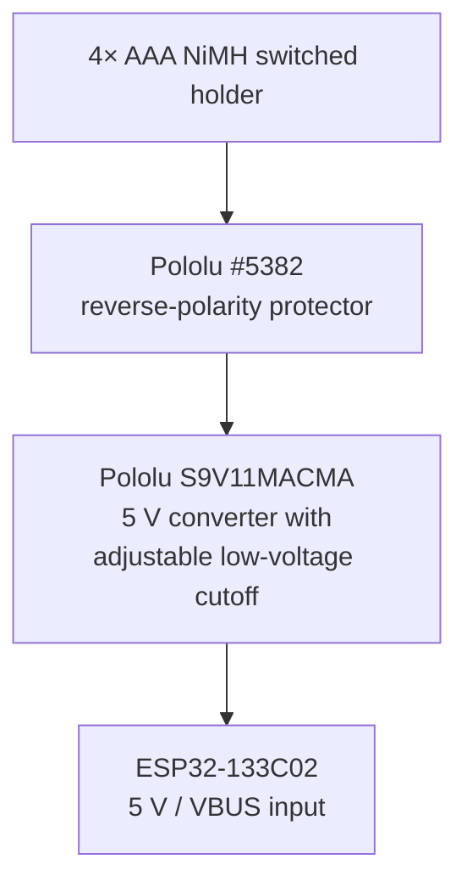
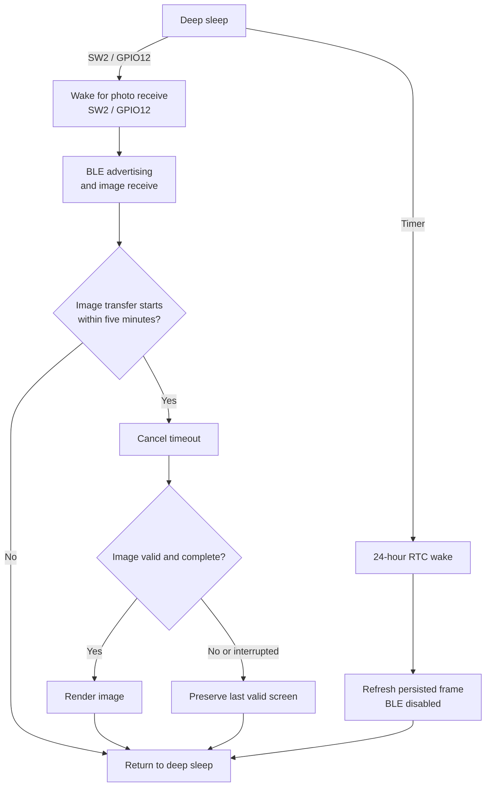

# hof_frame project plan

## Project

Build a Hall of Fame frame around a 13.3-inch GDEP133C02 Spectra 6 color e-ink display and Good Display ESP32-133C02 controller, powered by four AAA NiMH cells and eventually running custom Rust firmware.

## Hardware

- Display: Good Display GDEP133C02, 13.3-inch, 1600×1200, Spectra 6 color e-ink.
- Controller: Good Display ESP32-133C02 with ESP32-S3-WROOM-1.
- Memory assumption: 8 MB PSRAM and 16 MB flash; confirm usable configuration during bring-up.
- Wake button: SW2, provisionally assigned to GPIO12. Confirm active level, pull arrangement, and RTC wake suitability against the board schematic.
- Battery: four matched Green Cell AAA (R03) 950 mAh NiMH cells in a series holder. The series pack is 950 mAh at approximately 4.8 V nominal (4.56 Wh nominal).
- Battery holder: [Allegro 4×AAA holder with integrated switch](https://allegro.pl/produkt/koszyk-na-4-baterie-aaa-4xaaa-z-wlacznikiem-czarny-4c5bce7c-e839-49d4-b6d2-8abc42cdc347?offerId=17382812988).
- Reverse-polarity protection: [Pololu Ideal Diode Reverse Voltage Protector #5382](https://www.pololu.com/product/5382).
- Voltage converter: [Pololu S9V11MACMA #2868](https://www.pololu.com/product/2868), a step-up/step-down converter set to 5.0 V with a built-in adjustable low-voltage cutoff.
- Charging: remove the cells and use a dedicated four-cell NiMH charger. Do not use a Li-ion TP4056 charger or an improvised constant-voltage charger.

### Power path



The four-cell pack is approximately 4.8 V nominal and may be close to 6 V immediately after charging. The S9V11MACMA accepts the pack's voltage range and regulates the controller supply. A fuse or resettable PTC is optional overcurrent protection, not a voltage-compatibility requirement. The USB-C input must not be back-fed into a computer or charger.

The S9V11MACMA provides the hardware low-battery cutoff: its input voltage
feeds the EN pin through an 11-turn cutoff potentiometer, and the converter
sleeps when EN falls below 0.7 V. Set the cutoff from the cell discharge limit
and loaded testing; start from about 4.4 V for the four-cell pack (1.1 V/cell)
and adjust after measurement. This is not a Green Cell specification.

This cutoff is **not latching**. Its hysteresis turns the converter back on
when EN rises above 0.8 V, i.e. at about 114% of the cutoff voltage (about
5.0 V for a 4.4 V cutoff). After the load stops, cell voltage may recover but
is expected to remain below that restart point; verify this on the bench with
real discharged cells. If a restart is observed, lower the cutoff or switch off
the holder. The converter in sleep still draws about 7 µA per volt on VIN, so
switch off the holder or remove the cells for prolonged storage.

A pack-level voltage cutoff cannot detect that one cell is weaker than the
other three. Use four matched cells of the same age and capacity, charge and
replace them as a set, and characterize the cutoff with real cells. If
protection of each individual cell is required, monitor each cell separately;
do not treat total pack voltage alone as a guarantee against an individual
cell being over-discharged.

The holder listing and board specifications must be checked against the physical parts when received. Record measured dimensions, switch behavior, wiring, current draw, display timing, and battery runtime separately from these assumptions.

### Battery-runtime target

The intended usage profile is one received photo every 14 days and one
mandatory full panel refresh every 24 hours. The first engineering estimate
for the PoC power path is **one to two months per charged pack**; design for
**about six weeks** until input-side measurements replace it. This is not a
measured result.

The daily refresh is not expected to be the largest drain. The planned
five-minute BLE receive window for each photo is the principal lifetime
limiter, so measure actual transfer duration and reduce that timeout before
finalizing the production behavior. The runtime calculation must use the
measured energy for 14 scheduled refreshes, one BLE/photo-transfer wake, and
the continuous sleep load over each 14-day interval. Use cutoff-limited
capacity, rather than the 950 mAh rating, as the available capacity.

The preliminary input-side budget for one 14-day interval is:

| Component | Assumption | Estimated pack use |
|---|---|---:|
| Scheduled full refreshes | 14 refreshes at 1 W for 30 s, 90% conversion efficiency | ~27 mAh |
| S9V11MACMA and PoC sensor-module idle draw | 0.2 mA regulator quiescent current plus 0.128 mA divider current for 14 days | ~110 mAh |
| BLE/photo-transfer wake | One five-minute wake averaging 50–100 mA at the pack | ~250–500 mAh |
| **Subtotal** | Excludes the ESP32 controller deep-sleep current | **~387–637 mAh** |

These figures are engineering assumptions, not measurements. The display
refresh estimate includes the controller and panel during a refresh, but the
BLE and continuous-load figures must be verified at the switched holder input.

Define a conservative low-battery cutoff for the pack. Measure the minimum loaded pack voltage at which the reverse-polarity protector, S9V11MACMA, and controller still start reliably, then prevent a new wake/transfer cycle below that threshold; the converter's built-in cutoff disables its output. The cutoff must be based on measured loaded voltage, not only nominal NiMH voltage.

### Battery-voltage measurement and cutoff circuit

Measure the pack on the switched-holder side of the power path, before the #5382 protector and converter. Use a high-impedance divider to a confirmed spare ESP32-S3 ADC input:

```text
Battery+ after holder switch ── 100 kΩ ──┬── ADC input
                                         │
                                       33 kΩ
                                         │
Battery− / system GND ───────────────────┘
```

Add approximately 100 nF from the ADC input to ground. The divider scales a 0–6.0 V pack to 0–1.49 V and draws about 36 µA at 4.8 V. Use 1% resistors, keep the ADC trace away from the converter's switching node, and calibrate the ADC against a multimeter at two or more known battery voltages. Sample several readings and average them only after the converter and display load have reached a stable state.

Characterize the cutoff with a bench supply or a discharged matched cell pack:

1. Connect a current-limited supply through the holder switch, protector, and S9V11MACMA. Start at a fully charged pack voltage.
2. Log pack voltage at the holder, converter 5 V output, controller reset state, BLE startup, and display refresh while lowering the input in small steps.
3. Repeat the test during the highest expected load, including BLE activity and a display refresh. Record the lowest voltage at which startup and refresh remain reliable.
4. Set the firmware low-battery threshold above the measured failure point with engineering margin. On wake, sample the pack before starting BLE; below the threshold, skip the transfer and return to deep sleep.
5. Repeat with real cells and check each cell's voltage near cutoff. Pack
   voltage alone cannot confirm that a weak cell has not been over-discharged.

The ADC check is a secondary firmware safeguard; it cannot protect the cells
before the MCU samples the voltage. Set the S9V11MACMA output to 5.0 V first,
then set its cutoff by measuring VIN and EN and adjusting the cutoff
potentiometer so that `EN / 0.7 V = VIN / VIN_cutoff`. Set the threshold above
both the pack-equivalent cell discharge limit and the converter/protector
minimum operating voltage (the regulator needs 3 V to start and runs down to
2 V), with margin confirmed by loaded testing. Because the cutoff is not
latching, verify with a bench supply and real cells that unloaded voltage
rebound after shutdown does not cause repeated restarts. The pack-level cutoff
does not replace per-cell monitoring if individual-cell protection is
required.

## Physical frame

The physical design and fit-check prototype are considered complete for planning purposes. The frame must accommodate:

- Display panel and front bezel.
- ESP32-133C02 board and display cable.
- Battery holder with cell-removal access and switch access.
- #5382 protector, S9V11MACMA converter, wiring, and cable bend radius.
- Rear cover, service access, and wall/stand mounting.

## Firmware behavior

Target the ESP32-S3-WROOM-1 using an ESP-IDF-backed Rust project with NimBLE for the initial implementation. This is preferred over a pure `esp-hal` implementation because BLE/GATT and deep-sleep support are the highest-risk requirements.



Required behavior:

1. Wake from deep sleep using SW2/GPIO12 or the 24-hour RTC timer and identify the wake cause.
2. On a button wake, initialize BLE and advertise an image-transfer service.
3. Start a five-minute idle timer on BLE advertising, then reduce it after measuring real transfer duration.
4. Cancel the timer when a valid image transfer starts.
5. Receive and validate a complete image.
6. Decode, resize or crop to exactly 1600×1200, apply the required Spectra 6 color conversion and dithering, persist a display-ready frame, and render only a complete, decodable, integrity-checked image.
7. On an RTC wake, refresh the persisted frame with BLE disabled, then return to deep sleep.
8. Below the measured low-battery threshold, do not start a BLE transfer or display refresh; the converter's built-in cutoff disables its output.
9. A failed transfer leaves the current persisted frame and panel contents unchanged.

## BLE image transfer

- Accepted formats: PNG and JPEG.
- Maximum size: 4 MiB for the encoded transfer.
- Reject unsupported formats and oversized images before allocating storage.
- Enforce the limit on declared size, cumulative received bytes, chunk offsets, and final commit.
- Use a simple one-client, one-shot protocol: a client connects, sends one image, receives success or failure, and is disconnected. No pairing or application-level access control is required; anyone nearby may upload an image.
- Use a versioned protocol with transfer metadata, chunk numbering, acknowledgements/retries, integrity validation, and explicit commit/cancel messages.
- Start the five-minute idle timer on wake/advertising and cancel it only when the first valid transfer data is accepted. Once transfer starts, replace it with a shorter transfer-inactivity timeout so a stalled client cannot keep the frame awake indefinitely.
- Decode only after the complete encoded image has been received and validated.
- Reject images whose decoded width, height, pixel count, or working-memory requirement exceeds configured decoder limits, regardless of encoded size. This prevents decompression bombs and oversized malformed images from exhausting RAM.
- Stretch or crop every accepted image to exactly 1600×1200, then map pixels to the display's Spectra 6 palette with mandatory dithering.
- Store only the current encoded transfer in bounded temporary memory. Discard it after successful rendering, but retain the display-ready frame in non-volatile storage so the mandatory 24-hour refresh can reproduce it. Update that stored frame atomically only after complete image validation.

The final protocol still needs concrete UUIDs, metadata layout, chunk size, hash/CRC choice, and transfer-inactivity timeout.

## Firmware milestones

1. Confirm the ESP32-S3-WROOM-1 configuration, board GPIO map, display bus, SW2/GPIO12 wake polarity, PSRAM, flash layout, and BLE support.
2. Create a minimal ESP-IDF-backed Rust project that builds, can be flashed during development, logs the wake cause, and enters/exits deep sleep.
3. Bring up the display with a simple test pattern and validate the refresh sequence.
4. Implement SW2 and 24-hour RTC wake handling, including the low-battery behavior for scheduled refreshes.
5. Implement BLE advertising and the receive window; measure and reduce the five-minute timeout.
6. Implement the chunked PNG/JPEG transfer with the 4 MiB guardrail.
7. Decode, color-map, atomically persist, and render one validated image.
8. Refresh the persisted frame after an RTC wake with BLE disabled.
9. Measure startup, display-refresh, BLE, idle, and deep-sleep current.

Developer flashing is required during implementation, but end-user firmware flashing and replacement procedures are intentionally deferred.

## Documentation and maintenance

Keep the README and supporting files aligned with the measured project:

- Hardware bill of materials and power wiring.
- Confirmed GPIO map and display interface.
- Frame/CAD files and assembly notes.
- Firmware state machine and BLE protocol.
- PNG/JPEG preparation and 4 MiB limit.
- Normal operation and interrupted-transfer recovery.
- Converter low-battery cutoff behavior and measured loaded-voltage threshold.
- Measured current, refresh timing, wireless reliability, and battery runtime.

Clearly label provisional assumptions versus confirmed specifications and measured values.

## Reference links

- [ESP32-133C02 product page](https://www.good-display.com/product/574.html)
- [ESP32-133C02 specification](https://www.good-display.com/companyfile/2035.html)
- [Pololu S9V11MACMA #2868](https://www.pololu.com/product/2868)
- [Pololu ideal-diode protector #5382](https://www.pololu.com/product/5382)
- [4×AAA switched holder](https://allegro.pl/produkt/koszyk-na-4-baterie-aaa-4xaaa-z-wlacznikiem-czarny-4c5bce7c-e839-49d4-b6d2-8abc42cdc347?offerId=17382812988)
