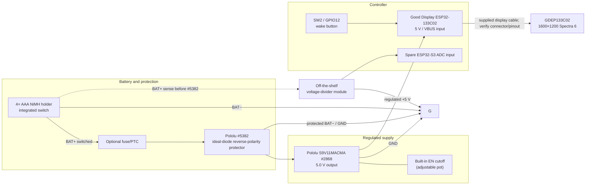

# Wiring diagram and bill of materials

This document describes the proof-of-concept wiring for the Hall of Fame
frame. It prioritizes off-the-shelf modules and separates confirmed
connections from values that must be checked on the received boards. Do not
power the controller until the converter output has been measured.

## Wiring diagram



For the proof of concept, use an off-the-shelf passive DC voltage-sensor
module, commonly sold as a `0–25 V` or `0–25 V 5:1 voltage divider` module.
[This 25 V voltage-sensor module](https://phippselectronics.com/product/25v-voltage-sensor-module/)
is a representative example:

```text
BAT+ after holder switch ── module VIN / +
BAT− / system GND ───────── module GND / −
module VOUT / S ──────────── confirmed spare ESP32-S3 ADC input
```

These modules are normally only resistor dividers; they need no supply
connection. A typical 5:1 module produces 0.96 V from a 4.8 V pack and 1.2 V
from a 6.0 V pack, which is suitable for the ESP32-S3 ADC input. Confirm the
actual divider ratio and that its maximum output is within the confirmed ADC
input range before connecting it. Keep its output wire away from the
S9V11MACMA switching node.

Typical 0–25 V modules use a 30 kΩ and 7.5 kΩ divider, drawing approximately
128 µA from a 4.8 V pack. This is acceptable for the PoC but is a permanent
sleep-current cost. When this power system is consolidated onto a custom PCB,
replace the module with a 100 kΩ upper resistor, 33 kΩ lower resistor, and
100 nF ADC filter capacitor. That circuit scales 0–6.0 V to approximately
0–1.49 V and draws about 36 µA at 4.8 V.

## Estimated runtime per charged pack

With four matched Green Cell 950 mAh AAA NiMH cells, the series pack is
950 mAh at approximately 4.8 V nominal (4.56 Wh). For the specified profile
of one received photo every 14 days and one full panel refresh every 24 hours,
the preliminary estimate is **one to two months per charged pack**. Plan for
**about six weeks** until it is measured on the final hardware.

This estimate includes 14 scheduled refreshes and one BLE/photo-transfer wake
per 14-day period. It assumes approximately 750 mAh remains usable before the
loaded low-battery cutoff, about 90% converter efficiency, an estimated
1 W/30 s full refresh, and a five-minute BLE wake averaging 50–100 mA at the
pack. The S9V11MACMA's low-load current and this PoC's 128 µA sensor module also
consume capacity continuously. Actual ESP32 deep-sleep current, refresh
energy, BLE current, and cutoff-limited capacity remain unmeasured.

The preliminary input-side budget for one 14-day photo interval is:

| Component | Assumption | Estimated pack use |
|---|---|---:|
| Scheduled full refreshes | 14 refreshes at 1 W for 30 s, 90% converter efficiency | ~27 mAh |
| S9V11MACMA and PoC sensor-module idle draw | 0.2 mA regulator quiescent current plus 0.128 mA divider current for 14 days | ~110 mAh |
| BLE/photo-transfer wake | One five-minute wake averaging 50–100 mA at the pack | ~250–500 mAh |
| **Subtotal** | Excludes the ESP32 controller deep-sleep current | **~387–637 mAh** |

Measure these values at the switched battery-holder input, before the
protector and converter, so the final result includes losses from the complete
power path.

The five-minute BLE window is the largest uncertainty and likely lifetime
limiter; reduce it after measuring normal photo-transfer duration. Do not use
this estimate for a battery replacement schedule until it has been confirmed
by a full discharge test through this complete power path.

## Connection schedule

| From | To | Connection | Status / requirement |
|---|---|---|---|
| Holder BAT+ after switch | #5382 VIN+ | Switched battery positive | Required |
| Holder BAT− | #5382 VIN− and system GND | Battery return | Required |
| #5382 VOUT+ | S9V11MACMA VIN+ | Protected battery positive | Required |
| #5382 VOUT− | S9V11MACMA VIN−/GND | Protected battery return | Required |
| S9V11MACMA VOUT+ | ESP32-133C02 5 V/VBUS input | Regulated 5 V | Verify board label and polarity |
| S9V11MACMA GND | ESP32-133C02 GND | Common return | Required |
| Holder BAT+ after switch | Voltage-sensor module VIN/+ | Battery measurement source | Must be before #5382 |
| Holder BAT− | Voltage-sensor module GND/− | Measurement return | Common system ground |
| Voltage-sensor module VOUT/S | Confirmed spare ESP32-S3 ADC input | Pack-voltage sense | Confirm output range, ratio, and GPIO in board schematic |
| SW2 | GPIO12 and its intended pull-up/pull-down arrangement | Wake input | Confirm active level and RTC wake support |
| ESP32-133C02 display connector | GDEP133C02 | Supplied display cable | Do not substitute a cable or assume pin order |

The USB-C input on the controller must not be used in a way that back-feeds
the battery-powered 5 V rail into a computer or charger. During development,
use the board's documented programming/power arrangement and verify that the
battery converter and USB supply are not simultaneously driving the same rail.

## Bring-up and cutoff procedure

1. Install matched, removable AAA NiMH cells only after all continuity checks.
2. With the controller disconnected, verify holder polarity, switch operation,
   and continuity through the #5382 protector.
3. Set the S9V11MACMA output to 5.0 V with its output potentiometer. Measure
   it with the battery connected and no controller load.
4. Confirm the controller input pin and ground from the ESP32-133C02
   documentation, then connect the regulated output.
5. Confirm the ADC reading against a multimeter at at least two known pack
   voltages and calibrate the firmware.
6. Characterize startup and display-refresh reliability while lowering the
   loaded pack voltage. Set the firmware cutoff above the measured failure
   point with engineering margin.
7. On wake, sample the pack before BLE or display work. Below the firmware
   threshold, skip the transfer and display refresh. The converter's built-in
   cutoff remains the primary protection.

The S9V11MACMA has a built-in low-voltage cutoff: its input voltage feeds the
EN pin through the cutoff potentiometer, and the converter sleeps when EN falls
below 0.7 V. No separate monitor board is needed. The ADC check is only a
secondary firmware safeguard and cannot protect the pack before the MCU
samples.

To set the cutoff:

1. With the controller disconnected, power the board from a bench supply or
   the cells and set the output to 5.0 V.
2. Measure VIN and EN, then turn the cutoff potentiometer until
   `EN / 0.7 V = VIN / VIN_cutoff`. Clockwise raises the cutoff. For example,
   with VIN = 5.4 V and a 4.4 V target, EN should be about 0.86 V.
3. Verify by lowering a bench supply until the output switches off.

Start with about 4.4 V for the four-cell pack (1.1 V/cell); this is a test
value, not a Green Cell specification. Choose the final threshold above the
cell discharge limit and above the minimum voltage at which the protector,
converter, or controller becomes unreliable, with margin confirmed under load.
The regulator needs 3 V to start and runs down to 2 V.

The cutoff is **not latching**. The converter restarts when EN rises above
0.8 V, i.e. when VIN reaches about 114% of the cutoff (about 5.0 V for a 4.4 V
cutoff). Cells recover somewhat once the load stops; verify with real
discharged cells that the pack stays below the restart voltage and the
converter does not repeatedly restart. In sleep, the board still draws about
7 µA per volt on VIN, so switch off the holder or remove the cells for
prolonged storage. A four-cell series voltage only reports the sum, so it
cannot identify a weak individual cell: keep the cells matched, charge and
replace them as a set, and use per-cell monitoring if protection of each cell
is required.

## Bill of materials

| Item | Qty. | Part / specification | Notes |
|---|---:|---|---|
| 1 | 1 | Good Display GDEP133C02, 13.3-inch, 1600×1200 Spectra 6 panel | Includes or uses the matching display cable |
| 2 | 1 | Good Display ESP32-133C02 controller with ESP32-S3-WROOM-1 | Confirm usable PSRAM/flash and the 5 V/VBUS input |
| 3 | 1 | 4× AAA NiMH holder with integrated switch | Use the planned Allegro holder; retain cell-removal access |
| 4 | 4 | Matched Green Cell AAA/R03 950 mAh NiMH cells | Remove cells for charging in a dedicated 4-cell NiMH charger |
| 5 | 1 | Pololu #5382 ideal-diode reverse-voltage protector | Connect between switched holder output and converter |
| 6 | 1 | [Pololu S9V11MACMA #2868](https://www.pololu.com/product/2868) step-up/step-down converter with adjustable low-voltage cutoff | Set output to 5.0 V and cutoff (start ~4.4 V) before connection; not latching |
| 7 | 1 | [Passive 0–25 V, 5:1 DC voltage-sensor module](https://phippselectronics.com/product/25v-voltage-sensor-module/) | PoC battery-voltage measurement; verify its actual resistor values and ratio |
| 8 | 1 set | Insulated hookup wire, suitable gauge, heat-shrink, and labels | Keep power and signal wiring short and strain-relieved |
| 9 | 1 | Dedicated charger for four NiMH cells | Required; do not use TP4056 or a constant-voltage charger |
| 10 | 1 | Multimeter and current-limited bench supply | Bring-up and loaded-voltage cutoff characterization |
| 11 | 1 | Optional fuse or resettable PTC | Extra overcurrent protection; choose rating after measured load |

Items 1–6 are the primary assembly. Item 7 is required for PoC firmware
battery monitoring. Items 8–10 are assembly/service equipment rather than
frame electronics; item 11 is optional. Validate the converter's cutoff and
restart behavior with real cells before regular battery use.

## Assembly notes

- Keep the battery holder accessible so cells can be removed for charging.
- Provide access to the holder switch and enough bend radius for the supplied
  display cable.
- Secure the #5382 and S9V11MACMA so their terminals cannot contact the frame or
  display backplane.
- Label BAT+, protected BAT+, regulated +5 V, and GND before final assembly.
- Record measured dimensions, switch behavior, loaded voltages, current,
  display refresh timing, wireless reliability, and runtime separately from
  this provisional wiring plan.
