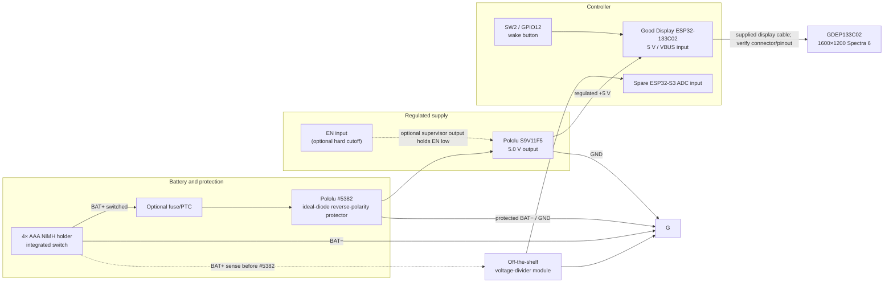

# Wiring diagram and bill of materials

This document describes the proof-of-concept wiring for the Hall of Fame
frame. It prioritizes off-the-shelf modules and separates confirmed
connections from values that must be checked on the received boards. Do not
power the controller until the converter output has been measured.

## Wiring diagram



For the proof of concept, use an off-the-shelf passive DC voltage-sensor
module, commonly sold as a `0–25 V` or `0–25 V 5:1 voltage divider` module.
[This 25 V voltage-sensor module](https://phippselectronics.com/product/25v-voltage-sensor-module/)
is a representative example:

```text
BAT+ after holder switch ── module VIN / +
BAT− / system GND ───────── module GND / −
module VOUT / S ──────────── confirmed spare ESP32-S3 ADC input
```

These modules are normally only resistor dividers; they need no supply
connection. A typical 5:1 module produces 0.96 V from a 4.8 V pack and 1.2 V
from a 6.0 V pack, which is suitable for the ESP32-S3 ADC input. Confirm the
actual divider ratio and that its maximum output is within the confirmed ADC
input range before connecting it. Keep its output wire away from the
S9V11F5 switching node.

Typical 0–25 V modules use a 30 kΩ and 7.5 kΩ divider, drawing approximately
128 µA from a 4.8 V pack. This is acceptable for the PoC but is a permanent
sleep-current cost. When this power system is consolidated onto a custom PCB,
replace the module with a 100 kΩ upper resistor, 33 kΩ lower resistor, and
100 nF ADC filter capacitor. That circuit scales 0–6.0 V to approximately
0–1.49 V and draws about 36 µA at 4.8 V.

## Connection schedule

| From | To | Connection | Status / requirement |
|---|---|---|---|
| Holder BAT+ after switch | #5382 VIN+ | Switched battery positive | Required |
| Holder BAT− | #5382 VIN− and system GND | Battery return | Required |
| #5382 VOUT+ | S9V11F5 VIN+ | Protected battery positive | Required |
| #5382 VOUT− | S9V11F5 VIN−/GND | Protected battery return | Required |
| S9V11F5 VOUT+ | ESP32-133C02 5 V/VBUS input | Regulated 5 V | Verify board label and polarity |
| S9V11F5 GND | ESP32-133C02 GND | Common return | Required |
| Holder BAT+ after switch | Voltage-sensor module VIN/+ | Battery measurement source | Must be before #5382 |
| Holder BAT− | Voltage-sensor module GND/− | Measurement return | Common system ground |
| Voltage-sensor module VOUT/S | Confirmed spare ESP32-S3 ADC input | Pack-voltage sense | Confirm output range, ratio, and GPIO in board schematic |
| SW2 | GPIO12 and its intended pull-up/pull-down arrangement | Wake input | Confirm active level and RTC wake support |
| ESP32-133C02 display connector | GDEP133C02 | Supplied display cable | Do not substitute a cable or assume pin order |

The USB-C input on the controller must not be used in a way that back-feeds
the battery-powered 5 V rail into a computer or charger. During development,
use the board's documented programming/power arrangement and verify that the
battery converter and USB supply are not simultaneously driving the same rail.

## Bring-up and cutoff procedure

1. Install matched, removable AAA NiMH cells only after all continuity checks.
2. With the controller disconnected, verify holder polarity, switch operation,
   and continuity through the #5382 protector.
3. Set the S9V11F5 output to 5.0 V if adjustment is required. Measure it with
   the battery connected and no controller load.
4. Confirm the controller input pin and ground from the ESP32-133C02
   documentation, then connect the regulated output.
5. Confirm the ADC reading against a multimeter at at least two known pack
   voltages and calibrate the firmware.
6. Characterize startup and display-refresh reliability while lowering the
   loaded pack voltage. Set the firmware cutoff above the measured failure
   point with engineering margin.
7. On wake, sample the pack before BLE or display work. Below the cutoff,
   skip the transfer and return to deep sleep.

The ADC check does not prevent the converter from briefly starting before the
MCU samples. If a hard cutoff is required, add a low-power adjustable
supervisor or resistor-set comparator powered from the switched battery. Its
open-drain output must hold the S9V11F5 EN pin low below the characterized
threshold, with hysteresis to prevent chatter. Validate this circuit on a
bench supply before connecting the controller.

## Bill of materials

| Item | Qty. | Part / specification | Notes |
|---|---:|---|---|
| 1 | 1 | Good Display GDEP133C02, 13.3-inch, 1600×1200 Spectra 6 panel | Includes or uses the matching display cable |
| 2 | 1 | Good Display ESP32-133C02 controller with ESP32-S3-WROOM-1 | Confirm usable PSRAM/flash and the 5 V/VBUS input |
| 3 | 1 | 4× AAA NiMH holder with integrated switch | Use the planned Allegro holder; retain cell-removal access |
| 4 | 4 | Matched AAA/R03 NiMH cells, approximately 750–1000 mAh | Remove cells for charging in a dedicated 4-cell NiMH charger |
| 5 | 1 | Pololu #5382 ideal-diode reverse-voltage protector | Connect between switched holder output and converter |
| 6 | 1 | Pololu S9V11F5 step-up/step-down converter | Adjust/verify regulated output at 5.0 V before connection |
| 7 | 1 | [Passive 0–25 V, 5:1 DC voltage-sensor module](https://phippselectronics.com/product/25v-voltage-sensor-module/) | PoC battery-voltage measurement; verify its actual resistor values and ratio |
| 8 | 1 set | Insulated hookup wire, suitable gauge, heat-shrink, and labels | Keep power and signal wiring short and strain-relieved |
| 9 | 1 | Dedicated charger for four NiMH cells | Required; do not use TP4056 or a constant-voltage charger |
| 10 | 1 | Multimeter and current-limited bench supply | Bring-up and loaded-voltage cutoff characterization |
| 11 | 1 | Optional fuse or resettable PTC | Extra overcurrent protection; choose rating after measured load |
| 12 | 1 | Optional low-power voltage supervisor/comparator with adjustable threshold | Only for a hard battery cutoff through S9V11F5 EN |

Items 1–6 are the primary assembly. Item 7 is required for PoC firmware
battery monitoring. Items 8–10 are assembly/service equipment rather than
frame electronics; items 11–12 are optional and must not be fitted without
validating their effect on converter startup and sleep current.

## Assembly notes

- Keep the battery holder accessible so cells can be removed for charging.
- Provide access to the holder switch and enough bend radius for the supplied
  display cable.
- Secure the #5382 and S9V11F5 so their terminals cannot contact the frame or
  display backplane.
- Label BAT+, protected BAT+, regulated +5 V, and GND before final assembly.
- Record measured dimensions, switch behavior, loaded voltages, current,
  display refresh timing, wireless reliability, and runtime separately from
  this provisional wiring plan.
