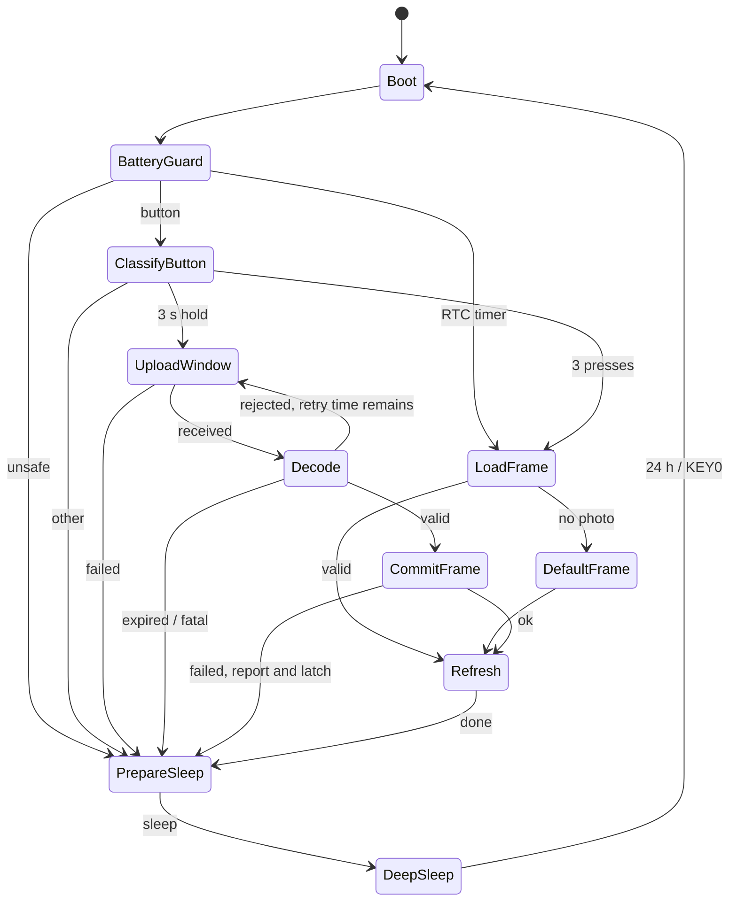
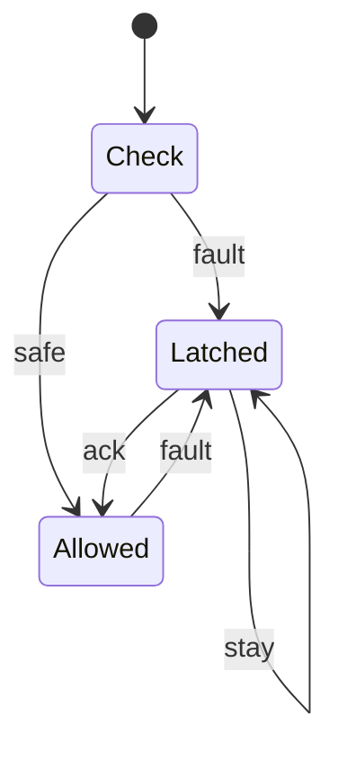

# Firmware state machine and implementation requirements

This document expands the [project plan](../docs/PLAN.md#firmware-behavior)
into firmware states and implementation contracts. It describes the **target**,
not the current bring-up program. See the [firmware README](README.md) for
implemented behavior and build instructions.

## Current baseline and hardware constraints

- Exactly two modes remain: default production and Cargo feature `usb`.
  Retired save-only, display-only, preview, and USB-bench feature names are not
  aliases. Both modes perform real upload/process/save/display and share
  progress reporting, bounded retries, storage, overlays, and panel cleanup.
- Production uses real deep sleep, RTC-retained scheduling, 24-hour scheduled
  refresh, one-hour manual limit, and persistent `hof_safety` recovery. Battery
  voltage measurement/protection and qualified latch acknowledgement are not
  implemented; it is not battery-ready firmware.
- USB logs simulated deep sleep and stays awake. It physically refreshes
  60 seconds after successful upload/manual/timer completion, with the same
  one-hour manual limit. Initialization starts a fresh awake schedule without
  immediate boot refresh. This does not qualify RTC retention, wake causes,
  sleep current, battery power, or real battery recovery.
- USB's simulated fault starts OFF each boot. A debounced active-low KEY1/GPIO3
  press while idle toggles it, blocking uploads and manual/timer refreshes.
  Holding the switch does not repeat. Clearing the simulated fault retains
  the original deadline; overdue scheduled work may run immediately.
  KEY1 polling is suspended during synchronous gesture/upload/display work;
  it does not interrupt active work or act as an emergency stop.
- Runtime safety is separate: production uses persistent `hof_safety`; USB
  uses `hof_usb` but logs and resets its previous state to Clean each reboot,
  including after interrupted work or brownout. This explicit development
  policy is not battery-qualified recovery and requires USB/bench power.
  USB panel init/show failures are nonfatal only after successful panel
  power-off, SPI release, and durable safety cleanup. They are logged in serial
  output, not stored as latched faults. Uploads report saved-but-not-displayed
  and close the AP normally; buttons remain available and the next scheduled
  attempt waits 60 seconds after failure cleanup. No display success or manual
  limit consumption is recorded. Storage, setup, radio, and cleanup faults
  still stop work for the rest of the session; KEY1 cannot clear them.
  NVS errors still block boot. Production latch behavior remains
  unchanged; USB never reads/clears it. No partition erasure is performed.
- A Working marker precedes work; successful cleanup commits Clean before
  final browser success. AP shutdown failure after success remains an explicit
  fault. The state byte remains authoritative and compatible; `diag_v1`
  stores phase/reason, and `last_fault_v1` preserves the latest fault across
  success and USB session reset. Boot reports both before resetting USB state.
  Working-at-boot records Interrupted; actual brownout takes precedence;
  invalid safety metadata and explicit runtime faults have distinct reasons.
  Phases cover setup, upload, decode, save, frame load, display, panel/safety/
  radio cleanup, idle, and unknown legacy work. KEY1 affects none of these
  persistent diagnostic records. No timestamp or arbitrary error text is stored.
  Missing legacy diagnostics cannot reconstruct a historical cause; invalid
  diagnostics and read/write failures explicitly block work. Multi-key NVS
  writes are not transactional; interruption can leave incomplete history.
  NVS power-loss behavior still needs qualification; missing metadata cannot
  distinguish first use from external erasure.
- KEY0/GPIO2 is active-low with pull-up: hold three seconds for upload, triple
  press within three seconds for manual refresh. Debounce is 50 ms. Production
  handles a stuck switch with a 60-second release timeout and timer-only sleep.
- AP is one-client WPA2 HOF-Frame at checked `192.168.4.1/24`, with local
  build-time credentials and no default. Browser Stretch/Fit normalizes
  PNG/JPEG to a display-sized PNG. Device PNG decoding is static/non-interlaced,
  row-based, bounded, alpha-over-white, with ordered six-color dithering.
  Raw JPEG is not device-decoded. Input is capped at 7 MB (7,000,000 bytes)
  and staged in flash, not held in PSRAM. Decode uses a 4 KiB buffered reader.
- Wi-Fi stays active during verified save and panel refresh. A chunked POST
  stream updates Send image / Process image / Update display / Complete.
  Initial HTTP 200 is not final success. Terminal success follows actual
  display and durable cleanup; AP closes after six seconds. Receive/decode
  rejections permit retries within the original window, without fallback
  refresh or persistent red error mark. Lost client connections are not
  cancellation once image work has started.
- Flash has two 1 MiB packed-frame slots with header/payload CRCs, generation
  selection, readback, and publication tag last. Validated frames are mapped
  read-only; missing/corrupt photos generate white, but I/O faults remain
  explicit. Landscape is native at 800 x 480; portrait rotates clockwise into it.
- Both modes render the same 120 x 48 status box with full battery icon and
  unknown `?%`, up-to-24-pixel text, and 16-pixel corner margins. No fake charge
  percentage. Saved pixels are unchanged. Font/license details and accepted
  hardware observations are in the [README](README.md).
- The XIAO ESP32-S3 Plus has 16 MiB flash and 8 MiB octal PSRAM at 40 MHz.
  Large ordinary
  allocations prefer PSRAM, with 32 KiB internal reserve for DMA/internal
  requests. The full 4 MiB PSRAM write/read and Rust Vec growth regression
  checks remain, yielding every 64 KiB (~1.6 seconds measured).
- The ED2208 panel uses CS44, DC10, RST38, MOSI GPIO9, SCK GPIO7, BUSY4, and
  active-high panel enable GPIO43; BUSY is active-low with 120-second
  per-wait bounds. SPI device/bus are cleaned after rendering. The EE04's
  built-in battery ADC (GPIO1, enabled by GPIO6) is for its single-cell Li-ion
  connector; NiMH operation uses an external divider on candidate ADC1 GPIO8.
  Verify the pads, divider, and calibration before implementing battery reads.
  See [wiring requirements](../docs/WIRING.md).
- The two-mode migration, KEY1 simulation, and real USB timer need board
  acceptance. Existing successful USB upload/manual/retry tests do not qualify
  production sleep/wake or battery operation. Stop accelerated panel cycles
  when bench work ends; closing the serial monitor does not stop firmware.

## Wake cycle

Deep-sleep wake restarts the program; it does not resume an in-memory state.
Read the reset reason, wake cause, persistent safety metadata, and calibrated
battery voltage before dispatching work. A GPIO2 low wakes the MCU immediately;
the button gesture is classified in firmware after wake (see
[KEY0 gestures](#key0-gestures)).

**Automatic refresh is required every nominal 24 hours**, without a button
press or an upload. The 24-hour period restarts **only when a refresh
happens** (daily, manual, cold boot, or after an upload). Wakes that do not
refresh, such as a short press, an upload window that times out, or a
rate-limited triple press, keep the original deadline: arm the RTC timer for
the time remaining until 24 hours after the last refresh. Keep the
last-refresh time in RTC memory; the RTC counter keeps running in deep sleep.

When the timer expires, boot, check battery safety, load and validate the
saved frame, refresh the screen with Wi-Fi off, and return to sleep with a
fresh 24-hour timer. Low battery or a set safety latch skips the refresh and
arms a new 24-hour timer to re-check. A missing or invalid saved frame falls
back to the [default frame](#default-frame). The interval is not tied to a
time of day.



| From | Label | Meaning |
| --- | --- | --- |
| DeepSleep | 24 h / KEY0 | Automatic RTC wake after nominally 24 hours, or GPIO2 (KEY0) button wake. |
| Boot | — | Reset and wake causes and recovery metadata read. |
| BatteryGuard | unsafe | Voltage below threshold, or latch set and not cleared. |
| BatteryGuard | button / RTC timer | Safe KEY0 wake for gesture classification, or safe scheduled wake to refresh the saved frame. |
| ClassifyButton | 3 s hold / 3 presses / other | See [KEY0 gestures](#key0-gestures); `3 presses` is the manual refresh. |
| LoadFrame | valid / no photo | Persisted frame passes validation, or is missing/corrupt (corruption logged). |
| DefaultFrame | — | Generated white screen with battery indicator. |
| UploadWindow | received | Complete bounded upload; stream stage events over HTTP while Wi-Fi remains on. |
| UploadWindow | failed | Idle timeout, deadline, disconnect, or rejected upload. |
| Decode | valid / failed | Validated candidate, or page error; retry within original window for rejections, stop/latch for memory faults. No fallback refresh. |
| CommitFrame | ok / failed | Verified atomic commit, or page error and stop/latch; retain any valid committed frame, no fallback refresh. |
| Refresh | done | Completed, or failed within its time bound. |
| PrepareSleep | sleep | Peripherals off, button released, RTC timer armed for 24 hours after the last refresh. |

Power-on, manual reset, brownout, and watchdog reset also enter `Boot`.
Brownout or an unfinished work marker sets the safety latch before any normal
dispatch. On first boot no photo exists, so any refresh shows the
[default frame](#default-frame). On a cold boot with a valid photo saved (for
example after a battery swap), refresh the saved photo through the normal
battery guard and cleanup path; this confirms the frame works and updates the
battery indicator.

### Default frame

When no valid photo is saved (first boot, never uploaded, or the stored frame
fails validation), refresh with a frame generated in firmware instead of
skipping the refresh:

- Entire screen white.
- The [battery indicator](#battery-indicator) in its default position.

The default frame is generated on each use, not stored, so it needs no flash
space and cannot be corrupted. A corrupt stored frame is logged, and is replaced
only by the next successful upload.

What each refresh shows when a photo may be missing:

| Situation | Screen |
| --- | --- |
| First boot, or never uploaded | White default frame + battery box |
| Stored photo fails validation | White default frame + battery box (corruption logged) |
| Valid photo saved | Saved photo + battery box |
| Upload received, then decode/save fails, valid photo saved | No refresh; panel left unchanged; error on web page |
| Upload received, then decode/save fails, **no** valid photo saved | No refresh; panel left unchanged; error on web page |
| Upload never received (timeout, disconnect, rejected) | No refresh; panel left unchanged |

A failed decode/save never initiates a panel refresh. A panel fault during an
otherwise valid upload can leave an incomplete image; report it on the page,
cut panel power, latch work, and do not automatically retry in production.
USB mode instead continues after successful cleanup under the development
policy above; it does not claim that the saved image was displayed.

### Battery indicator

Every refresh, photo or default frame, draws a small rectangle with the
battery percentage. Draw it at render time over the stored frame; do not bake
it into the stored photo, so the value is current on each daily refresh.

- Position is chosen on the upload page: top right (default), top left,
  bottom left, or bottom right. Store the choice with the frame metadata so
  daily, manual, and cold-boot refreshes reuse it. Corners are relative to
  the chosen display orientation.
- The percentage is derived from the calibrated pack voltage. NiMH voltage is
  flat over most of the discharge, so map it with a measured discharge curve
  and treat the value as approximate.
- **Failed battery reading** (ADC error or an impossible value): show `?`
  instead of the percentage and carry on normally. The S9V11MACMA hardware
  cutoff remains the protection; at worst the frame simply switches off. A
  failed reading cannot set the low-battery latch, but brownout and
  unfinished-work latching still apply.
- Style: black text on a white box with a black border. Initial dimensions:
  **120 x 48 pixels**, with up to **24-pixel-high smooth text** and a **16-pixel
  margin** from the two edges of the selected corner. Use a smooth font
  rather than the test screen's bitmap style; select the font and rendering
  support during implementation. Fit the full battery symbol and `100%` together
  without clipping. Verify legibility and adjust after a panel preview.
- Upload results and failures appear on the web page, not in the battery box.
  Manual-refresh failure is visible from the screen itself and serial logs;
  no persistent upload-error flag or extra fallback refresh is planned.

### Low-battery screen

When the low-battery latch first sets, refresh once with a "Replace
batteries" screen, then stop refreshing until the latch is cleared. Do this
only if the measured voltage still has margin for one refresh above the
converter cutoff; otherwise skip it and keep the current picture. Show it at
most once per latch event; record that it was shown with the latch so later
wakes do not repeat it. The stored photo is unchanged, and the first refresh
after the latch is cleared shows it again.

### Photo orientation and fit

- The person chooses **landscape (800 x 480) or portrait (480 x 800)** on
  the upload page. Store it with the frame metadata. The firmware maps the
  chosen layout onto the panel's native 800 x 480 landscape pixel order.
- The upload page offers **Stretch** (fill the chosen layout, changing
  proportions) and **Fit** (preserve the whole image with white borders).
  Browser canvas resizing produces a display-sized PNG before transmission;
  original source files are limited to 7 MB (7,000,000 bytes) in the browser,
  and the transmitted PNG has the same 7,000,000-byte limit. Flash staging
  preserves decoder memory; the updated partition table must be reflashed.
  Crop-to-fill is not implemented.

### State contracts

| State | Required work | Exit condition |
| --- | --- | --- |
| Boot | Initialize logging, capture reset/wake causes, read metadata, start global awake deadline/watchdog supervision. Keep radio and panel off. | Recovery information available, or explicit recovery error. |
| BatteryGuard | Sample battery before Wi-Fi; apply low/recovery thresholds and latch rules. | Work permitted, or safe sleep requested. |
| ClassifyButton | Classify the KEY0 gesture with debouncing: continuous three-second hold or triple press. Ignore later presses during work. | Upload, manual refresh, or sleep. |
| UploadWindow | Start WPA2 AP and HTTP server, then idle timer. Allow rejected attempts to retry without extending the window; keep AP on during processing. | Final result sent, bounded expiry, or fatal fault. |
| Decode | With radio on, validate/decode the browser-normalized PNG, rotate/map to six colours with dithering. | Complete candidate frame or explicit failure. |
| CommitFrame | Atomically publish the fully validated candidate without destroying the previous committed frame on failure. | New frame committed, or old frame retained. |
| LoadFrame | Validate stored metadata, length, palette, orientation, and integrity before reading pixels for refresh. | Valid frame, or no photo (missing or corrupt, logged). |
| DefaultFrame | Generate a white frame with the battery-percentage rectangle. | Frame ready for refresh. |
| Refresh | Power and initialize panel, stream only a validated frame, wait for bounded completion. | Success or explicit driver/timeout failure. |
| PrepareSleep | Stop HTTP/AP, release buffers, power panel off, finalize recovery metadata only if safe, handle held button, arm KEY0 wake and the RTC timer (24 hours after the last refresh). | Enter deep sleep or report shutdown failure. |

All operations must return errors to the cycle coordinator rather than
silently treating a failed upload, commit, or refresh as success. Log state
transitions, reset/wake causes, failure reasons, and elapsed time over serial.
Do not log credentials or uploaded image contents.

### KEY0 gestures

KEY0/GPIO2 is the upload/manual-refresh button. The press that wakes the controller counts
as the first press, because it may already be released by the time firmware
runs; the wake cause records it.

| Gesture | Detection | Action |
| --- | --- | --- |
| Long hold | The waking press stays continuously low (pressed) for three seconds, ignoring sub-debounce chatter. | Open the upload window. |
| Triple press | Two more debounced presses after the waking press, all within the gesture window measured from wake. | Manual refresh of the persisted frame, Wi-Fi off (same path as the RTC refresh). |
| Anything else | Fewer presses, or a hold released before three seconds, by the end of the window. | Return to sleep. |


`press 1` is the GPIO2 wake itself. `press 2` and `press 3` must arrive
within the gesture window; `timeout` means the window expired first.

- The gesture window is **3 s from wake**, as chosen. Verify it on the
  bench against boot time and comfortable press speed. A long hold is
  separate: it only counts on the waking press, and needs the full three seconds.
- Detect presses by polling or edge interrupt with roughly 20–50 ms debounce;
  count debounced falling edges (released HIGH to pressed LOW), not samples.
  Resolve any pending release debounce before accepting a three-second hold.
- Decide on the third press; further presses are ignored. Before sleep, wait
  for release as on every other path.
- Manual refresh goes through the battery guard, latch, `LoadFrame`, and
  cleanup exactly like a timer wake. No valid photo means the default frame. A
  triple press does not clear the low-battery latch; only the qualified
  three-second hold above the recovery threshold does.
- A manual refresh restarts the 24-hour period, like any refresh.
- **At most one manual refresh per hour.** A triple press within an hour of
  the last manual refresh is ignored and the frame returns to sleep without
  changing the timer deadline. Store the last manual-refresh time in RTC
  memory; after power loss the limit resets, which is acceptable.
- Start the gesture timer at wake and keep sampling KEY0 during boot and the
  battery check, so a quick second press is not missed.
  Current bring-up timing starts at Rust application entry, after bootloader
  execution; edges before GPIO sampling are not captured. The normal path
  classifies before logging/recovery work; D9 battery sampling is only used for
  the website estimate and is not a low-voltage guard.

## Upload and image transaction

### What the user sees during the upload window

1. Hold KEY0 for three seconds. The board creates its own Wi-Fi hotspot.
2. Join that network from a phone or computer using the printed password.
   Stay connected even if the device warns that the network has no internet.
3. Open `http://192.168.4.1` in a browser. The board serves the upload page;
   no external website or internet connection is needed.
4. While waiting for a photo, the page shows **"No upload started. Hotspot
   closes in X seconds."** The countdown reflects the board's remaining idle window,
   not a new five-minute timer started when the page opens. Loading or
   reloading the page does not extend the window.
5. Choose the layout (landscape or portrait) and battery-indicator corner
   (top right by default, top left, bottom left, bottom right), select a
   PNG/JPEG, and upload it. Replace the idle countdown with upload
   progress/status once the upload starts, because transfer deadlines now
   apply instead.
6. Immediately after clicking upload, show a four-stage progress bar:
   **Send image → Process image → Update display → Complete**. The first stage
   covers browser resizing and upload progress; the board confirms receipt.
   Stream actual processing/display transitions over the POST and keep Wi-Fi
   active through decode, verified commit, refresh,
   panel/SPI cleanup, and durable safety cleanup. Return final success only
   after these complete. Save-only mode explicitly reports no display refresh.
7. After success, leave the AP on for six seconds so the result can reach the
   browser, then stop it and sleep (mocked in debug modes). No Done button or
   explicit acknowledgement is required. Recoverable errors return the remaining
   original retry window and re-enable the form. Fatal hardware/safety failures
   report best effort, allow six seconds for delivery, then close AP and latch.
   Idle expiry without an upload closes AP without changing the picture.

Supply the remaining idle duration from the board when serving the page and
use it for the browser countdown; the board remains authoritative for timeout
enforcement. Do not promise an exact sleep countdown after upload, since
processing and panel refresh duration vary.

```mermaid
sequenceDiagram
    participant Browser
    participant HTTP as AP / HTTP server
    participant Pipeline as Image pipeline
    participant Store as Frame storage
    participant Panel
    Browser->>HTTP: GET upload page
    Browser->>HTTP: POST PNG/JPEG
    Note over HTTP: Enforce transfer limits; preserve original retry deadline
    alt Request invalid, interrupted, oversized, or timed out
        HTTP-->>Browser: Error if connection still usable
        Note over HTTP,Panel: Preserve frame and panel; retry while original window remains
    else Complete upload passes receive-stage checks
        HTTP-->>Browser: 200 OK, chunked progress stream: received
        Note over HTTP: Keep response stream and AP on
        HTTP->>Pipeline: Bounded encoded buffer
        Pipeline->>Pipeline: Decode, stretch, rotate, dither, validate
        alt Decode or validation fails
            HTTP-->>Browser: Decode rejection and remaining retry time
            Note over Pipeline,Panel: No refresh; allow bounded retry
        else Candidate is valid
            Pipeline->>Store: Atomically commit candidate
            alt Commit fails
                HTTP-->>Browser: Save failure; no retry
                Note over HTTP,Panel: No refresh; close AP after result grace and latch
            else Commit succeeds
                HTTP-->>Browser: processed, then displaying
                Store->>Panel: Render committed frame
                Note over Store,Panel: Keep committed frame even if refresh fails
                alt Refresh and durable cleanup succeed
                    HTTP-->>Browser: displayed, then terminal success
                    Note over HTTP: Six-second grace, then AP off
                else Refresh or cleanup fails
                    HTTP-->>Browser: Failure; saved photo retained, no retry
                    Note over HTTP: Six-second grace, then AP off and latch
                end
            end
        end
    end
```

- Network name (SSID) **`HOF-Frame`**, WPA2. The password is fixed at build
  time (for example from an environment variable or an ignored local config
  file), never committed to git, and printed on the frame. Serve the page at
  `http://192.168.4.1`. One client and one successful upload per wake, without an
  app-level login.
- Allow PNG/JPEG only, with a maximum encoded body of **7 MB (7,000,000 bytes)**.
  Check declared size before flash writes and cumulative size while streaming,
  including chunked or unknown-length bodies.
  Stage through a 4 KiB buffer into the temporary 7 MiB upload partition,
  erasing sectors on demand within the transfer deadline. Only a completely
  received body is decoded. Staging never modifies the saved-frame slots.
  Storage failures block work; malformed/interrupted requests permit bounded
  retry. Upload bytes remain in flash until overwritten, not securely erased.
- The initial idle window is five minutes from AP startup. Upload start replaces
  it with an inactivity timeout and an absolute transfer deadline, both
  **2 minutes** initially. Keep all timeouts as named constants in one place
  so they are easy to change after measuring real uploads. A global awake
  deadline gates decode, storage, and starting refresh. Rejections do not
  extend the initial idle/global deadline for new attempts. Accepted work
  may finish after idle expiry. The current panel driver uses bounded BUSY
  waits rather than interruption at the global deadline.
- No extra upload checksum: TCP handles transmission errors, and decode
  validation rejects damaged images.
- `200 OK` starts the POST progress stream after receive validation; it is not
  final success. Flushed stage lines report actual completion, with no invented
  time-based percentage for decode/display. A terminal `success` confirms work
  and durable cleanup. `retry` includes remaining seconds; `fatal` blocks retries.
  Missing final events or incomplete responses mean unknown outcome.
  Failure responses distinguish retryable decode/receive rejection from fatal
  storage/panel/safety faults. A broken connection means the final outcome is
  unknown, not that work failed; avoid automatic retry. A delivered TCP write
  does not guarantee the browser read it. AP shutdown failure after confirmation
  remains an explicit blocking fault, independent of successful image work.
- Decoded dimension, pixel-count, and working-memory limits are mandatory even
  for small encoded files. Use row/strip processing and JPEG downscaling where
  supported; reject unsupported progressive/interlaced cases explicitly.
- The packed panel frame is **960,000 bytes** at four bits per pixel. Budget
  encoded data, frame storage buffers, decoder/dither workspace, network
  allocations, and internal/DMA memory together against measured availability.
- Keep image processing independent of the transport so a later BLE receiver
  can supply the same bounded encoded input.

### Persistent transaction and recovery

Persist the last valid display-ready frame, format/version, dimensions,
orientation, length, and integrity information. Choose the storage layout after
confirming flash capacity; allow enough space for an old committed frame and a
candidate, plus metadata and the application.

Publish the new frame only after complete decode and validation. A reset
during candidate writing or metadata publication must leave a recognizable
valid committed frame, not a partially written image presented as current.
Atomic frame publication does not make the physical refresh atomic: power loss
can still leave the panel partly updated. A committed new frame remains the
recovery source if its subsequent refresh fails.

Set a persistent work-in-progress marker before transfer, flash-frame writing,
or refresh. Clear it only after the cycle has finished safely, immediately
before sleep. Expected input failures may finish cleanly after candidate
cleanup; an interrupted or uncertain storage/refresh operation must not be
marked clean. Marker/latch write failures are recovery errors, not permission
to proceed. Exact metadata storage and power-loss guarantees remain to be
designed and tested.

## Low-battery latch



| Label | Meaning |
| --- | --- |
| fault | Low voltage, brownout reset, or unfinished work marker. |
| safe | No latch set and voltage above the low threshold. |
| stay | Timer wake, short press, triple press, or voltage below the recovery threshold. |
| ack | Qualified three-second KEY0 hold with voltage above the recovery threshold. |

The latch survives resets and battery removal. On every power-on check voltage
against the recovery threshold, because a cell swap and converter restart look
the same. While latched, timer wakes only re-check and sleep; no Wi-Fi, image
writes, or refresh. Establishing or clearing safety metadata is the necessary
exception to the no-write rule, and must not become a write on every latched
wake. Do not clear the latch merely because rested cells recover voltage.

Use the qualified KEY0 hold for acknowledgement, only above the measured
recovery threshold (higher than the low threshold). Clearing the latch must
complete before normal button dispatch. Neither threshold is a fixed nominal
NiMH voltage: confirm both under load with real cells, including sag margin
above converter cutoff. Firmware cannot prevent repeated resets if supply
power fails before it can run or persist its latch; verify converter behavior
separately.

## Sleep, deadlines, and fault handling

- The initial global awake-time budget is **10 minutes from boot**, including
  gesture detection, the idle/upload window, processing, storage, refresh,
  and cleanup. Reserve time for bounded operations and safe cleanup before
  starting new work; do not enforce the budget by blindly interrupting a flash
  write or panel refresh. Verify the budget against measured worst-case
  timings. Watchdog supervision remains separate. In current debug upload,
  checks guard processing/flash work and starting refresh; active panel waits
  use their driver bounds (120 seconds per BUSY wait). Final response writes
  and six-second result grace are additional bounded cleanup time.
- After a non-refresh wake, arm the timer for the time remaining until 24
  hours after the last refresh, not a fresh 24 hours. After a refresh or a
  low-battery skip, arm a full 24 hours. Measure RC-clock drift.
- Always cut panel power after display. Recoverable receive/decode rejections
  keep AP open within the original retry window; stop it on success after
  result grace, expiry, or fatal fault. Retain explicit shutdown errors.
- Do not arm active-low GPIO wake and sleep while KEY0 is held. Debounce
  release. **Stuck button:** if KEY0 is still pressed after **60 s** of waiting,
  sleep with only the RTC timer armed (button wake disabled) and log it. On the
  next timer wake, re-enable button wake if KEY0 is released; if it is still
  pressed, repeat the timer-only sleep. The daily refresh keeps working
  while the button is stuck.
- A watchdog resets the MCU; it does not itself enter deep sleep. Recovery on
  reboot must inspect reset cause and the work marker, and avoid retry loops.
- User-visible failure feedback: final web-page status for uploads, visible
  screen outcome for manual refresh, and the one-time
  [low-battery screen](#low-battery-screen).

## Implementation order and acceptance checks

| Step | Firmware that must be in place | Verification before advancing |
| --- | --- | --- |
| 1 | Restore button/sleep integration; add wake-cause dispatch, KEY0 gesture classification, and RTC timer. | Short press starts no work cycle; three-second hold dispatches upload once; triple press within the window dispatches refresh once; two presses or a slow third press sleep; held-button handling does not loop; timer wake keeps radio off. |
| 2 | Confirm ADC wiring, calibrate measurement, implement persistent latch and work marker. | Low voltage blocks loads; brownout/unfinished cycle latches; timer cannot clear latch; only qualified acknowledgement above recovery clears it. |
| 3 | Define frame orientation/format, partitions, atomic commit and validated loading. | Rotation/palette test image is correct; missing/corrupt frame shows the default frame with battery %; reset at each commit stage retains a valid committed frame. |
| 4 | Implement AP/page and bounded receive path with all deadlines. | Idle timeout; disconnect; stalled and slow-drip uploads; exactly 7,000,000 versus 7,000,001 bytes; false declared sizes and unknown-length bodies; flash staging faults and maximum-size timing on hardware. |
| 5 | Add bounded PNG/JPEG decode, stretch to chosen orientation, colour conversion and dithering. | Valid formats/orientations; malformed files; decoded-size bombs; unsupported decoder modes; peak memory within measured budget. |
| 6 | Integrate commit, panel refresh, web result, cleanup and reset recovery. | AP stays active until final success, then closes after six seconds; recoverable failures allow bounded retry; fatal save/display/cleanup failures report then latch; no fallback refresh/error mark; BUSY timeout shuts panel down; interrupted refresh recovers after safe acknowledgement. |
| 7 | Measure complete battery-powered operation. | Current at holder input for startup/AP/refresh/sleep; loaded thresholds; no converter cycling; 24-hour drift; full discharge runtime. |

These steps refine the [project milestones](../docs/PLAN.md#firmware-milestones),
not a claim that those features are already implemented. Hardware-in-loop
checks are required for power, wake, panel, and converter behavior.

## Decisions still required before implementation

- Measured low/recovery thresholds, the voltage-to-percentage curve, and
  safety-metadata storage/write guarantees at low voltage.
- Final idle, inactivity, and transfer timeouts after measuring real uploads;
  verify the chosen 10-minute global awake-time budget.
- Decoder support and limits, and flash partition/atomic-publication scheme.
