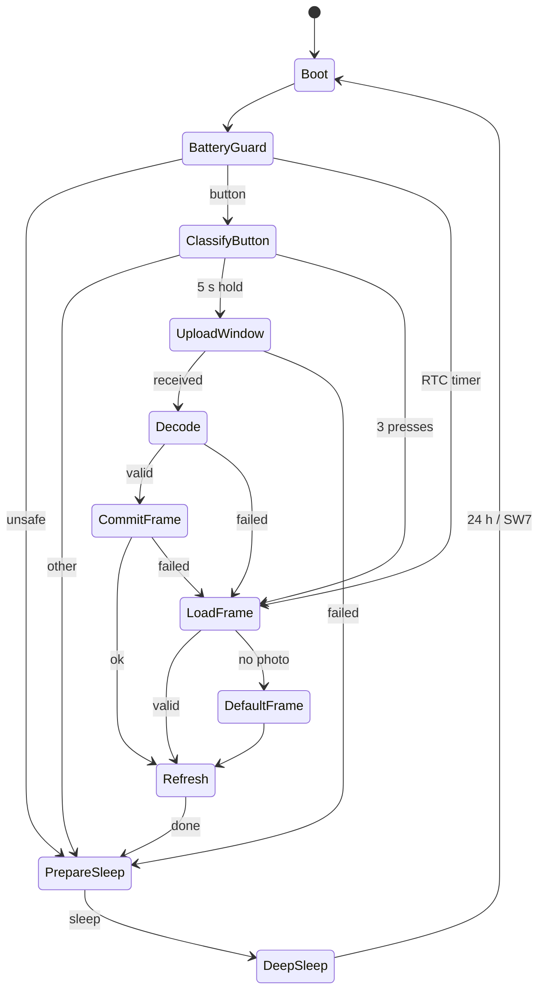
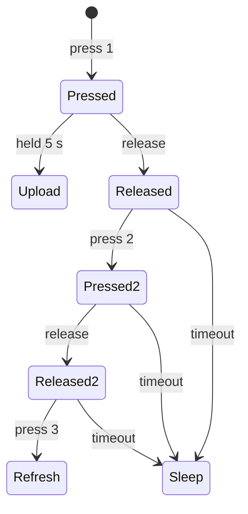
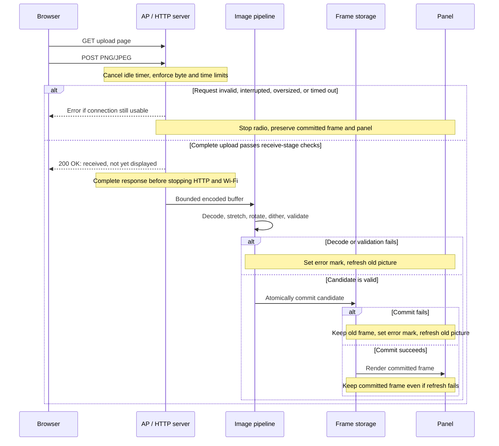
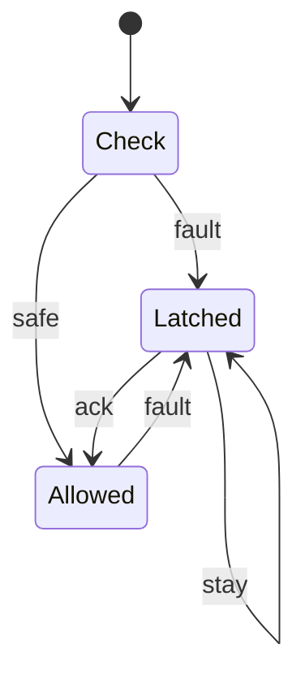

# Firmware state machine and implementation requirements

This document expands the [project plan](../docs/PLAN.md#firmware-behavior)
into firmware states and implementation contracts. It describes the **target**,
not the current bring-up program. See the [firmware README](README.md) for
implemented behavior and build instructions.

## Current baseline and hardware constraints

- [main.rs](src/main.rs) normally renders a validated saved packed frame or a
  plain white fallback with a render-time battery box showing `?`, handles
  SW7 wake, classifies the three-second triple-press and five-second hold, and
  enters deep sleep with a nominal 24-hour RTC refresh timer. It retains the
  last successful refresh time in RTC memory across deep sleep and
  rate-limits manual refreshes. A held button is given up to 60 seconds to
  release before button wake is disabled for that sleep. The five-second hold
  is detected but only logged; the upload window is not implemented. The
  gesture timing and debounce classifier has deterministic unit tests in
  `src/gesture.rs`; those tests do not qualify hardware timing. A failed
  scheduled refresh is retried after 24 hours to avoid a rapid retry loop.
- The `debug-upload` feature exercises that same classifier with mocked
  deep sleep and simulated timer/manual refreshes. It stays awake with continuous
  USB logging, treats the first SW7 press as wake, reports the result, and
  rearms after debounced release. A five-second hold opens the real upload
  window; panel work requires the explicit display feature.
  Shared scheduling logic in [schedule.rs](src/schedule.rs) is exercised with
  a 120-second daily interval, a 30-second manual limit, and one-second
  simulated successful refreshes. No-work wakes preserve the daily deadline;
  timer refreshes remain active while waiting for button release. Normal
  builds retain 24-hour/one-hour intervals and keep scheduling state in RTC
  memory. Both paths advance last-success timing only on refresh completion.
  Actual sleep/wake and boot latency are not tested in this mode.
  Retired button-only, gesture-only, fault-injection, and fixture-storage
  diagnostics have been removed; automated regression tests remain.
- The normal path commits an NVS work marker before refreshing and clears it
  after successful refresh/panel shutdown. Brownout, unfinished work, unknown
  metadata, or refresh failure latch work off; manual refresh cannot override
  it. NVS errors explicitly block work without automatic partition erasure.
  RTC cooldown remains supplementary scheduling metadata, not the safety latch.
  Normal acknowledgement is disabled until calibrated battery recovery checks
  exist. Mock mode has a separate safety namespace, explicitly simulated safe
  recovery voltage. Automated safety tests cover injected interruptions
  without a separate device feature. NVS power-loss
  guarantees still need hardware qualification; missing metadata initializes
  as first use and external erasure cannot be distinguished from first use.
- Packed-frame storage uses two 1 MiB slots in the 2 MiB `frames` partition,
  with size/palette/header/payload validation, CRC32s, generation selection,
  and header/tag-last publication after candidate readback. Normal rendering
  maps validated flash or generates white; invalid slots are logged. The
  upload pipeline commits and reloads candidates under the work marker. Frame format,
  rotation mapping, and torn-write behavior have host tests, not yet hardware
  acceptance. Orientation/corner metadata drives the render-time status box.
- `debug-upload` adds a real one-client WPA2 AP and local upload page to mock
  sleep mode. The receiver accepts bounded fixed-length/chunked raw PNG/JPEG
  bytes into PSRAM, checks the signature, responds with receipt-only status,
  shuts Wi-Fi down, then decodes a display-sized static PNG by rows, applies
  ordered six-color dithering, and atomically saves/reloads the packed frame.
  The page accepts PNG/JPEG and normalizes them to the chosen resolution
  using browser resizing; direct JPEG decoding on the board is not supported.
  PNG decoding sets a 128 KiB library-tracked allocation limit (not a total
  inflater workspace cap) and rejects wrong dimensions,
  interlacing, animation, and malformed input. The encoded upload and packed
  candidate use PSRAM; no full RGB image is allocated on the board.
  The mock work marker covers receiver, radio cleanup, decoding, and save.
  Decode rejection leaves the saved frame unchanged and cleans up; memory/
  storage faults latch work off. Panel refresh remains mocked unless the
  explicit `debug-upload-display` feature is enabled.
  That mode refreshes the validated saved frame after a successful upload/
  commit, with radio off and the encoded buffer released. The Working marker
  covers display, power-off, and SPI cleanup; failure latches without retry.
  Successful real display restarts the daily deadline. Startup, timer, and
  triple-press physical refreshes remain disabled in this mode; deep sleep
  stays mocked so USB logs continue. Use stable bench power; battery safety
  is still simulated.
  Credentials come from a local build environment variable, with no default.
  The AP explicitly configures `192.168.4.1/24` with DHCP; the ready message
  uses the checked live interface address after binding the HTTP listener.
  Idle/transfer/header/global deadlines and byte bounds are implemented.
  Header-stage failures close only the rejected TCP connection, not the
  hotspot; the initial idle/global deadline remains unchanged. Accepted
  upload-body failures still end the attempt and clean up the radio.
  Board logs confirm PSRAM tests, the corrected AP/DHCP subnet, receipt of
  3,192,335 bytes into PSRAM, receipt-response send, radio cleanup, and return
  to Clean mock sleep with the daily deadline unchanged and USB connected.
  Decode/commit and receiver boundary/failure paths still need qualification.
  The first decode aborted on a 128 KiB internal-heap inflater allocation;
  reboot correctly latched interrupted work. PSRAM-backed malloc is now
  enabled, with a startup Rust Vec allocation/growth regression check; this
  fix is board-confirmed: the 3,278,491-byte upload converted and committed/
  reloaded as slot 0/generation 3, CRC 949275097, then returned to Clean.
  The user reported upload-to-display worked flawlessly. Repeated cleanup
  and failure-path behavior still need qualification.
- A render-time 120 x 48 status box uses a subset DejaVu Sans outline font,
  24-pixel question-mark height, black text/border on white, and 16-pixel
  layout-relative corner margins. Text and placement rotate with landscape.
  Ordered black/white coverage represents antialiased outline edges without
  unsupported grayscale colors. Saved frame pixels are untouched. Both
  normal saved/default rendering and the upload-display test use this overlay;
  retired fixture-only diagnostics have been removed. Battery measurement is not
  qualified, so all current renders show `?`. Physical preview is pending.
  The label now uses a leading 17 x 11 filled battery icon and `?%` when unknown,
  or simulated `100%` with `debug-battery-preview`. Text scales down from a
  maximum 24-pixel height to fit the icon and label without enlarging the box.
  The full icon is a fixed symbol, not a measured charge level.
  Box width and height are 75% of the original 160 x 64 design.
- This is still bring-up firmware: normal upload/decode, battery measurement,
  persistent upload-error marks, and voltage-driven battery check/latch do
  not exist. Real display after upload is an explicit debug-only opt-in.
- [epd.rs](src/epd.rs) provides panel initialization, pixel streaming, refresh,
  waits while the active-low BUSY input is low (up to a 120-second timeout),
  and powers the panel off through the GPIO45 load switch. It does not require
  a new BUSY-low edge after a command.
- SW7/GPIO13 is the active-low, pull-up RTC wake input. SW8/GPIO12 has no assigned
  application function. SW2 is not fitted on the received board.
- Battery ADC GPIO4/ADC1_CH3 is only proposed: confirm accessibility, divider
  ratio, and calibration before enabling battery guards. The PoC divider and
  later PCB divider differ; see [wiring requirements](../docs/WIRING.md).
- Hardware is the N16R8 module: 16 MiB flash (programmer-confirmed) and 8 MiB
  PSRAM. Board logs confirm octal 40 MHz initialization, the boot memory test,
  and `debug-upload` verification of physical capacity and a 4 MiB
  allocation/write/read test.
  Ordinary malloc/Rust allocations above 16 KiB now prefer PSRAM so decoder
  workspace does not depend on contiguous internal heap. Small allocations
  prefer internal RAM; allocator fallback is allowed. A 32 KiB internal pool
  is reserved for internal/DMA requests. Explicit upload/frame allocations
  remain PSRAM-only.
  The [partition table](partitions.csv) reserves 4 MiB for encoded uploads,
  separate from the packed-frame slots and 24 KiB NVS. The 4 MiB encoded limit
  is unchanged; the receiver explicitly allocates at most 4 MiB PSRAM rather
  than internal RAM. Decoder/working-memory budgets still need implementation.
  The current driver streams 1200 x 1600 portrait pixels; photos may be shown
  in landscape or portrait as chosen on the upload page (see
  [photo orientation and fit](#photo-orientation-and-fit)). Define and test the
  rotation between these
  coordinate systems rather than changing the physical panel geometry.

## Wake cycle

Deep-sleep wake restarts the program; it does not resume an in-memory state.
Read the reset reason, wake cause, persistent safety metadata, and calibrated
battery voltage before dispatching work. A GPIO13 low wakes the MCU immediately;
the button gesture is classified in firmware after wake (see
[SW7 gestures](#sw7-gestures)).

**Automatic refresh is required every nominal 24 hours**, without a button
press or an upload. The 24-hour period restarts **only when a refresh
happens** (daily, manual, cold boot, or after an upload). Wakes that do not
refresh, such as a short press, an upload window that times out, or a
rate-limited triple press, keep the original deadline: arm the RTC timer for
the time remaining until 24 hours after the last refresh. Keep the
last-refresh time in RTC memory; the RTC counter keeps running in deep sleep.

When the timer expires, boot, check battery safety, load and validate the
saved frame, refresh the screen with Wi-Fi off, and return to sleep with a
fresh 24-hour timer. Low battery or a set safety latch skips the refresh and
arms a new 24-hour timer to re-check. A missing or invalid saved frame falls
back to the [default frame](#default-frame). The interval is not tied to a
time of day.

| From | Label | Meaning |
| --- | --- | --- |
| DeepSleep | 24 h / SW7 | Automatic RTC wake after nominally 24 hours, or GPIO13 (SW7) button wake. |
| Boot | — | Reset and wake causes and recovery metadata read. |
| BatteryGuard | unsafe | Voltage below threshold, or latch set and not cleared. |
| BatteryGuard | button / RTC timer | Safe SW7 wake for gesture classification, or safe scheduled wake to refresh the saved frame. |
| ClassifyButton | 5 s hold / 3 presses / other | See [SW7 gestures](#sw7-gestures); `3 presses` is the manual refresh. |
| LoadFrame | valid / no photo | Persisted frame passes validation, or is missing/corrupt (corruption logged). |
| DefaultFrame | — | Generated white screen with battery indicator. |
| UploadWindow | received | Complete bounded upload; `200 OK` sent; HTTP and Wi-Fi stopped. |
| UploadWindow | failed | Idle timeout, deadline, disconnect, or rejected upload. |
| Decode | valid / failed | Validated display-ready candidate, or decode/memory-limit error (sets the error mark, then refreshes the old picture). |
| CommitFrame | ok / failed | Atomic commit succeeded, or failed with the old frame retained (sets the error mark, then refreshes the old picture). |
| Refresh | done | Completed, or failed within its time bound. |
| PrepareSleep | sleep | Peripherals off, button released, RTC timer armed for 24 hours after the last refresh. |

Power-on, manual reset, brownout, and watchdog reset also enter `Boot`.
Brownout or an unfinished work marker sets the safety latch before any normal
dispatch. On first boot no photo exists, so any refresh shows the
[default frame](#default-frame). On a cold boot with a valid photo saved (for
example after a battery swap), refresh the saved photo through the normal
battery guard and cleanup path; this confirms the frame works and updates the
battery indicator.

### Default frame

When no valid photo is saved (first boot, never uploaded, or the stored frame
fails validation), refresh with a frame generated in firmware instead of
skipping the refresh:

- Entire screen white.
- The [battery indicator](#battery-indicator) in its default position.

The default frame is generated on each use, not stored, so it needs no flash
space and cannot be corrupted. A corrupt stored frame is logged, and is replaced
only by the next successful upload.

What each refresh shows when a photo may be missing:

| Situation | Screen |
| --- | --- |
| First boot, or never uploaded | White default frame + battery box |
| Stored photo fails validation | White default frame + battery box (corruption logged) |
| Valid photo saved | Saved photo + battery box |
| Upload received, then decode/save fails, valid photo saved | Previous photo + battery box with red `!` |
| Upload received, then decode/save fails, **no** valid photo saved | White default frame + battery box with red `!` |
| Upload never received (timeout, disconnect, rejected) | No refresh; panel left unchanged |

A failed first upload therefore never leaves a half-drawn or blank-undefined
screen: the fallback is always the generated white frame.

### Battery indicator

Every refresh, photo or default frame, draws a small rectangle with the
battery percentage. Draw it at render time over the stored frame; do not bake
it into the stored photo, so the value is current on each daily refresh.

- Position is chosen on the upload page: top right (default), top left,
  bottom left, or bottom right. Store the choice with the frame metadata so
  daily, manual, and cold-boot refreshes reuse it. Corners are relative to
  the chosen display orientation.
- The percentage is derived from the calibrated pack voltage. NiMH voltage is
  flat over most of the discharge, so map it with a measured discharge curve
  and treat the value as approximate.
- **Failed battery reading** (ADC error or an impossible value): show `?`
  instead of the percentage and carry on normally. The S9V11MACMA hardware
  cutoff remains the protection; at worst the frame simply switches off. A
  failed reading cannot set the low-battery latch, but brownout and
  unfinished-work latching still apply.
- Style: black text on a white box with a black border. Initial dimensions:
  **120 x 48 pixels**, with up to **24-pixel-high smooth text** and a **16-pixel
  margin** from the two edges of the selected corner. Use a smooth font
  rather than the test screen's bitmap style; select the font and rendering
  support during implementation. Fit `100%` and the red error mark together
  without clipping. Verify legibility and adjust after a panel preview.
- **Error mark.** If an uploaded photo is received but then fails to decode,
  validate, or save, refresh the previous picture (or the default frame if
  none exists) and show a red exclamation mark in the battery box. Store the
  error flag persistently so the mark stays on later refreshes until the next
  successful upload clears it.

### Low-battery screen

When the low-battery latch first sets, refresh once with a "Replace
batteries" screen, then stop refreshing until the latch is cleared. Do this
only if the measured voltage still has margin for one refresh above the
converter cutoff; otherwise skip it and keep the current picture. Show it at
most once per latch event; record that it was shown with the latch so later
wakes do not repeat it. The stored photo is unchanged, and the first refresh
after the latch is cleared shows it again.

### Photo orientation and fit

- The person chooses **landscape (1600 x 1200) or portrait (1200 x 1600)** on
  the upload page. Store it with the frame metadata. The firmware maps the
  chosen layout onto the panel's native 1200 x 1600 portrait pixel order.
- The upload page offers **Stretch** (fill the chosen layout, changing
  proportions) and **Fit** (preserve the whole image with white borders).
  Browser canvas resizing produces a display-sized PNG before transmission;
  both source and transmitted file are limited to 4 MiB in the current page.
  Crop-to-fill is not implemented.

### State contracts

| State | Required work | Exit condition |
| --- | --- | --- |
| Boot | Initialize logging, capture reset/wake causes, read metadata, start global awake deadline/watchdog supervision. Keep radio and panel off. | Recovery information available, or explicit recovery error. |
| BatteryGuard | Sample battery before Wi-Fi; apply low/recovery thresholds and latch rules. | Work permitted, or safe sleep requested. |
| ClassifyButton | Classify the SW7 gesture with debouncing: continuous five-second hold or triple press. Ignore later presses during work. | Upload, manual refresh, or sleep. |
| UploadWindow | Start WPA2 AP and HTTP server, then idle timer. Accept at most one upload attempt. | Receipt completed or bounded failure. |
| Decode | With radio off, validate/decode PNG/JPEG, stretch to the chosen orientation, map to six colours with dithering. | Complete candidate frame or explicit failure. |
| CommitFrame | Atomically publish the fully validated candidate without destroying the previous committed frame on failure. | New frame committed, or old frame retained. |
| LoadFrame | Validate stored metadata, length, palette, orientation, and integrity before reading pixels for refresh. | Valid frame, or no photo (missing or corrupt, logged). |
| DefaultFrame | Generate a white frame with the battery-percentage rectangle. | Frame ready for refresh. |
| Refresh | Power and initialize panel, stream only a validated frame, wait for bounded completion. | Success or explicit driver/timeout failure. |
| PrepareSleep | Stop HTTP/AP, release buffers, power panel off, finalize recovery metadata only if safe, handle held button, arm SW7 wake and the RTC timer (24 hours after the last refresh). | Enter deep sleep or report shutdown failure. |

All operations must return errors to the cycle coordinator rather than
silently treating a failed upload, commit, or refresh as success. Log state
transitions, reset/wake causes, failure reasons, and elapsed time over serial.
Do not log credentials or uploaded image contents.

### SW7 gestures

SW7/GPIO13 is the only user button. The press that wakes the controller counts
as the first press, because it may already be released by the time firmware
runs; the wake cause records it.

| Gesture | Detection | Action |
| --- | --- | --- |
| Long hold | The waking press stays continuously low (pressed) for five seconds, ignoring sub-debounce chatter. | Open the upload window. |
| Triple press | Two more debounced presses after the waking press, all within the gesture window measured from wake. | Manual refresh of the persisted frame, Wi-Fi off (same path as the RTC refresh). |
| Anything else | Fewer presses, or a hold released before five seconds, by the end of the window. | Return to sleep. |

`press 1` is the GPIO13 wake itself. `press 2` and `press 3` must arrive
within the gesture window; `timeout` means the window expired first.

- The gesture window is **3 s from wake**, as chosen. Verify it on the
  bench against boot time and comfortable press speed. A long hold is
  separate: it only counts on the waking press, and needs the full five seconds.
- Detect presses by polling or edge interrupt with roughly 20–50 ms debounce;
  count debounced falling edges (released HIGH to pressed LOW), not samples.
  Resolve any pending release debounce before accepting a five-second hold.
- Decide on the third press; further presses are ignored. Before sleep, wait
  for release as on every other path.
- Manual refresh goes through the battery guard, latch, `LoadFrame`, and
  cleanup exactly like a timer wake. No valid photo means the default frame. A
  triple press does not clear the low-battery latch; only the qualified
  five-second hold above the recovery threshold does.
- A manual refresh restarts the 24-hour period, like any refresh.
- **At most one manual refresh per hour.** A triple press within an hour of
  the last manual refresh is ignored and the frame returns to sleep without
  changing the timer deadline. Store the last manual-refresh time in RTC
  memory; after power loss the limit resets, which is acceptable.
- Start the gesture timer at wake and keep sampling SW7 during boot and the
  battery check, so a quick second press is not missed.
  Current bring-up timing starts at Rust application entry, after bootloader
  execution; edges before GPIO sampling are not captured. The normal path
  classifies before logging/recovery work; battery sampling is not implemented.

## Upload and image transaction

### What the user sees during the upload window

1. Hold SW7 for five seconds. The board creates its own Wi-Fi hotspot.
2. Join that network from a phone or computer using the printed password.
   Stay connected even if the device warns that the network has no internet.
3. Open `http://192.168.4.1` in a browser. The board serves the upload page;
   no external website or internet connection is needed.
4. While waiting for a photo, the page shows **"No upload started: sleeping
   in X seconds."** The countdown reflects the board's remaining idle window,
   not a new five-minute timer started when the page opens. Loading or
   reloading the page does not extend the window.
5. Choose the layout (landscape or portrait) and battery-indicator corner
   (top right by default, top left, bottom left, bottom right), select a
   PNG/JPEG, and upload it. Replace the idle countdown with upload
   progress/status once the upload starts, because transfer deadlines now
   apply instead.
6. On successful receipt, show **"Upload received. Wi-Fi is closing; the
   screen will update next, then the frame will sleep."** This confirms byte
   receipt, not successful decoding or display. On rejection, show the error
   before shutdown if the connection is still usable.
7. The board stops Wi-Fi, processes and saves the image, refreshes the panel,
   then sleeps. If no upload starts before the idle countdown ends, it stops
   Wi-Fi and sleeps without changing the picture.

Supply the remaining idle duration from the board when serving the page and
use it for the browser countdown; the board remains authoritative for timeout
enforcement. Do not promise an exact sleep countdown after upload, since
processing and panel refresh duration vary.

- Network name (SSID) **`HOF-Frame`**, WPA2. The password is fixed at build
  time (for example from an environment variable or an ignored local config
  file), never committed to git, and printed on the frame. Serve the page at
  `http://192.168.4.1`. One client and one upload per wake, without an
  app-level login.
- Allow PNG/JPEG only, with a maximum encoded body of **4 MiB (4,194,304 bytes)**.
  Check declared size before allocation and cumulative size while streaming,
  including chunked or unknown-length bodies.
- The initial idle window is five minutes from AP startup. Upload start replaces
  it with an inactivity timeout and an absolute transfer deadline, both
  **2 minutes** initially. Keep all timeouts as named constants in one place
  so they are easy to change after measuring real uploads. A global awake
  deadline also covers decode, storage, refresh, and cleanup.
- No extra upload checksum: TCP handles transmission errors, and decode
  validation rejects damaged images.
- `200 OK` acknowledges receipt only. The page must explain that processing and
  refresh happen after disconnection and can still fail. Do not promise a
  displayed image or send a second HTTP result after Wi-Fi stops.
- Decoded dimension, pixel-count, and working-memory limits are mandatory even
  for small encoded files. Use row/strip processing and JPEG downscaling where
  supported; reject unsupported progressive/interlaced cases explicitly.
- The packed panel frame is **960,000 bytes** at four bits per pixel. Budget
  encoded data, frame storage buffers, decoder/dither workspace, network
  allocations, and internal/DMA memory together against measured availability.
- Keep image processing independent of the transport so a later BLE receiver
  can supply the same bounded encoded input.

### Persistent transaction and recovery

Persist the last valid display-ready frame, format/version, dimensions,
orientation, length, and integrity information. Choose the storage layout after
confirming flash capacity; allow enough space for an old committed frame and a
candidate, plus metadata and the application.

Publish the new frame only after complete decode and validation. A reset
during candidate writing or metadata publication must leave a recognizable
valid committed frame, not a partially written image presented as current.
Atomic frame publication does not make the physical refresh atomic: power loss
can still leave the panel partly updated. A committed new frame remains the
recovery source if its subsequent refresh fails.

Set a persistent work-in-progress marker before transfer, flash-frame writing,
or refresh. Clear it only after the cycle has finished safely, immediately
before sleep. Expected input failures may finish cleanly after candidate
cleanup; an interrupted or uncertain storage/refresh operation must not be
marked clean. Marker/latch write failures are recovery errors, not permission
to proceed. Exact metadata storage and power-loss guarantees remain to be
designed and tested.

## Low-battery latch

| Label | Meaning |
| --- | --- |
| fault | Low voltage, brownout reset, or unfinished work marker. |
| safe | No latch set and voltage above the low threshold. |
| stay | Timer wake, short press, triple press, or voltage below the recovery threshold. |
| ack | Qualified five-second SW7 hold with voltage above the recovery threshold. |

The latch survives resets and battery removal. On every power-on check voltage
against the recovery threshold, because a cell swap and converter restart look
the same. While latched, timer wakes only re-check and sleep; no Wi-Fi, image
writes, or refresh. Establishing or clearing safety metadata is the necessary
exception to the no-write rule, and must not become a write on every latched
wake. Do not clear the latch merely because rested cells recover voltage.

Use the qualified SW7 hold for acknowledgement, only above the measured
recovery threshold (higher than the low threshold). Clearing the latch must
complete before normal button dispatch. Neither threshold is a fixed nominal
NiMH voltage: confirm both under load with real cells, including sag margin
above converter cutoff. Firmware cannot prevent repeated resets if supply
power fails before it can run or persist its latch; verify converter behavior
separately.

## Sleep, deadlines, and fault handling

- The initial global awake-time budget is **10 minutes from boot**, including
  gesture detection, the idle/upload window, processing, storage, refresh,
  and cleanup. Reserve time for bounded operations and safe cleanup before
  starting new work; do not enforce the budget by blindly interrupting a flash
  write or panel refresh. Verify the budget against measured worst-case
  timings. Watchdog supervision remains separate.
- After a non-refresh wake, arm the timer for the time remaining until 24
  hours after the last refresh, not a fresh 24 hours. After a refresh or a
  low-battery skip, arm a full 24 hours. Measure RC-clock drift.
- Stop the radio and cut panel power on every recoverable exit, including init,
  decode, storage, and BUSY failures. Retain an explicit error if shutdown fails.
- Do not arm active-low GPIO wake and sleep while SW7 is held. Debounce
  release. **Stuck button:** if SW7 is still pressed after **60 s** of waiting,
  sleep with only the RTC timer armed (button wake disabled) and log it. On the
  next timer wake, re-enable button wake if SW7 is released; if it is still
  pressed, repeat the timer-only sleep. The daily refresh keeps working
  while the button is stuck.
- A watchdog resets the MCU; it does not itself enter deep sleep. Recovery on
  reboot must inspect reset cause and the work marker, and avoid retry loops.
- User-visible failure feedback: the battery-box
  [error mark](#battery-indicator) for failed uploads and the one-time
  [low-battery screen](#low-battery-screen).

## Implementation order and acceptance checks

| Step | Firmware that must be in place | Verification before advancing |
| --- | --- | --- |
| 1 | Restore button/sleep integration; add wake-cause dispatch, SW7 gesture classification, and RTC timer. | Short press starts no work cycle; five-second hold dispatches upload once; triple press within the window dispatches refresh once; two presses or a slow third press sleep; held-button handling does not loop; timer wake keeps radio off. |
| 2 | Confirm ADC wiring, calibrate measurement, implement persistent latch and work marker. | Low voltage blocks loads; brownout/unfinished cycle latches; timer cannot clear latch; only qualified acknowledgement above recovery clears it. |
| 3 | Define frame orientation/format, partitions, atomic commit and validated loading. | Rotation/palette test image is correct; missing/corrupt frame shows the default frame with battery %; reset at each commit stage retains a valid committed frame. |
| 4 | Implement AP/page and bounded receive path with all deadlines. | Idle timeout; disconnect; stalled and slow-drip uploads; exactly 4 MiB versus 4 MiB + 1; false declared sizes and unknown-length bodies. |
| 5 | Add bounded PNG/JPEG decode, stretch to chosen orientation, colour conversion and dithering. | Valid formats/orientations; malformed files; decoded-size bombs; unsupported decoder modes; peak memory within measured budget. |
| 6 | Integrate commit, panel refresh, cleanup and reset recovery. | Receipt precedes radio stop; decode/commit failure keeps the old image and shows the red error mark; next successful upload clears it; BUSY timeout shuts panel down; interrupted refresh recovers after safe acknowledgement. |
| 7 | Measure complete battery-powered operation. | Current at holder input for startup/AP/refresh/sleep; loaded thresholds; no converter cycling; 24-hour drift; full discharge runtime. |

These steps refine the [project milestones](../docs/PLAN.md#firmware-milestones),
not a claim that those features are already implemented. Hardware-in-loop
checks are required for power, wake, panel, and converter behavior.

## Decisions still required before implementation

- Measured low/recovery thresholds, the voltage-to-percentage curve, and
  safety-metadata storage/write guarantees at low voltage.
- Final idle, inactivity, and transfer timeouts after measuring real uploads;
  verify the chosen 10-minute global awake-time budget.
- Decoder support and limits, and flash partition/atomic-publication scheme.
